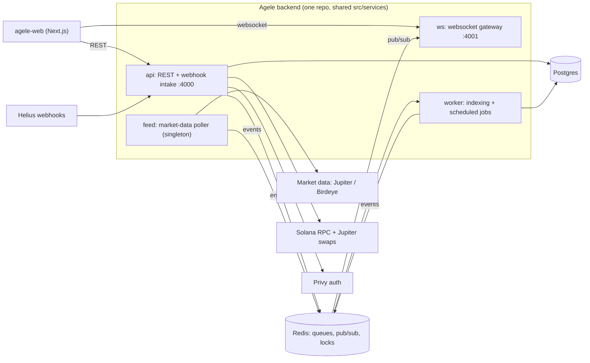

# Agele API

Backend for Agele, a social trading terminal for Solana spot markets: Bun + Hono REST/WebSocket API, Drizzle/Postgres, Redis, BullMQ worker. The Next.js frontend lives in [jog01/agele-web](https://github.com/jog01/agele-web).

- `docs/`: [architecture](docs/architecture.md), [flows](docs/flows.md), [decisions](docs/decisions.md), [data model](docs/data-model.md), [fee-payer security policy](docs/fee-payer-security-policy.md), [SOL quote and fees design](docs/sol-quote-and-fees.md)

## Architecture



Details in [docs/architecture.md](docs/architecture.md).

## Run locally

Requires Bun 1.4+ and Docker.

```bash
docker compose up -d          # Postgres + Redis (add --profile observability for Jaeger)
bun install
cp .env.example .env
bun run db:migrate
bun run dev                   # all four processes; REST :4000, WebSocket :4001/ws
```

By default the chain simulator runs without live keys. Set both Yellowstone
credentials to switch the same feed to finalized Solana events. In demo mode,
the feed backfills Pulse, swaps and candles on boot, and the API seeds fictional
traders and their history in PostgreSQL. Set `PRIVY_APP_ID` /
`PRIVY_VERIFICATION_KEY` to enable authenticated routes. See [social store](docs/social.md).

### Swap environment

- `JUPITER_BASE_URL`: defaults to `https://api.jup.ag`; `JUPITER_API_KEY` sets the `x-api-key` header when configured. Swap previews use live Jupiter, not demo quotes.
- `SPONSOR_ENABLED`: boolish (`true`/`false`/`1`/`0`), default `false`. With matching keys, wires the validating sponsor; otherwise build/submit return `503 trading_disabled`. Public quotes still work. Redis key `sponsor:kill` immediately blocks new sponsorship (delete manually after investigating).
- `FEE_PAYER_PUBKEY`: sponsor wallet address. `FEE_PAYER_SECRET`: development-only base58 64-byte secret or JSON 64-byte array; rejected outside `NODE_ENV=development`. Startup refuses a public-key mismatch. Neither is used by the disabled sponsor. Production managed signing is not yet implemented.
- `MAX_SLIPPAGE_BPS`: default `300`, client default `50`. `MAX_PRICE_IMPACT_PCT`: default `3` percentage points.
- `MAX_CU_PRICE_MICROLAMPORTS`: default `2000000`; `MAX_LAMPORTS_PER_TX`: default `10000000` (fees plus rent); `DAILY_SPEND_CAP_SOL`: default `1` (reserved globally before signing; exceeding it latches the Redis kill switch).
- `SPONSOR_REFERRAL_ACCOUNT` and `SPONSOR_REFERRAL_FEE_BPS` (50–255, default 50): Jupiter referral project account and requested fee. Required for sponsorship economics; referral/treasury keys must be separate from the SOL-only fee payer. Live market data must value the input mint and SOL; mock or missing prices fail closed. Users need ≥5 USDC and swaps ≥$5; estimated referral proceeds (80% integrator share) must cover gas/rent.

The sponsor checks v0/legacy messages, ALTs, programs/accounts/instructions, token extensions, message identity and user signatures; Redis atomically claims issued records and reserves quotas/spend before co-signing. It simulates at issue and co-sign, verifying payer and user balance bounds. JupiterZ and native-SOL output routes fail closed in this version; see the security policy's implementation map for all deliberate restrictions and operational gaps. Security tests use generated real Solana messages and fake chain state; Redis Lua integration tests use **local Redis database 15**, and repository tests need Postgres.
- Postgres persists issued swaps and execution outcomes; Redis enforces quote/issue limits (30/min per IP and authenticated issuing user), sponsorship quotas and the kill switch.

Swap routes: public `GET /v1/swaps/quote`, authenticated `POST /v1/swaps`, `POST /v1/swaps/{requestId}/submit`, and `GET /v1/swaps/{requestId}`. See [Trade](docs/flows.md#trade-quote-review-sign-receipt) and `/docs` for contracts.

## Trade indexing and portfolios

| Environment variable | Purpose |
| --- | --- |
| `HELIUS_API_KEY` | Helius management API key for `bun run helius:sync` |
| `HELIUS_WEBHOOK_SECRET` | Exact Authorization header expected on webhook delivery; enables indexed Redis rankings when set |
| `HELIUS_WEBHOOK_URL` | Public HTTPS callback, including `/v1/webhooks/helius`, used by sync |
| `SOLANA_RPC_URL` | JSON-RPC endpoint for linked-wallet USDC, USDT and native SOL balances |
| `DATABASE_URL` / `REDIS_URL` | PostgreSQL source of truth / rebuildable rankings and BullMQ |
| `PRIVY_APP_ID` / `PRIVY_APP_SECRET` | Auth verification / linked Solana wallet discovery |

To go live: migrate Postgres, run Redis, configure Privy and live market data,
set the Helius API key, strong webhook secret and public HTTPS callback URL,
then run `bun run helius:sync` after wallets are linked. **Rerun sync whenever
linked wallets change**; it is deliberately not called in the sign-in request
path (external management calls cost credits and can fail). Sync matches the
callback URL, creates or updates an enhanced `ANY` webhook, and refuses empty
wallet lists. No historical trades are backfilled. Never log management responses:
they may contain the webhook secret.

The [current Helius reference](https://www.helius.dev/docs/api-reference/webhooks/llms.txt)
documents `https://mainnet.helius-rpc.com/v0/webhooks` (rather than the older
`api-mainnet` hostname), with GET/POST and PUT `/{webhookID}`. The sync script
uses that base. [Request fields](https://www.helius.dev/docs/api-reference/webhooks/create-webhook)
include `webhookURL`, `accountAddresses`, `transactionTypes`, `webhookType`, `authHeader`.

Authenticated endpoints: `GET /v1/me/portfolio`, `GET /v1/me/portfolio/history?range=7d|30d|all`,
and `GET /v1/me/trades?limit=25&cursor=...`. Run `bun run dev:worker` for daily
UTC equity snapshots for users with positions or linked Solana wallets (including cash-only users).
Equity includes open positions plus linked-wallet USDC,
USDT (1 USD each), and native SOL at current SOL price; `usdcBalance` remains USDC only.
Missing/zero SOL prices value native SOL cash at zero. The API rebuilds rankings at startup and every 60 seconds,
and refreshes a user's rankings after each indexed trade. WS `leaderboard:global`
sends `{window,updatedAt}` invalidations; refetch `GET /v1/leaderboard`.

Limitations: only one non-quote token against USDC/USDT/SOL is indexed; transfers
and failed transactions are skipped. Native SOL fees are added back, wSOL is
merged with SOL, and SOL legs use the opening SOL/USD price of the trade's UTC
minute, persisted with the fill. Historical pricing for linked wallets requires
Birdeye. Missing history is retried, never replaced with the spot price.
Unknown market prices fall back to average cost (zero unrealized PnL).
RPC failures log and omit only the affected wallet/asset; successful balances are retained.
Tokens acquired before indexing or delivered out of order have unknown (zero) basis;
sells without indexed holdings record zero realized PnL. Transactions are not reordered.
Seeded leaderboard pages stay explicitly demo-labelled; indexed rankings never
fall back to synthetic entries on Redis failure.

## Checks

```bash
bun run check   # biome, tsc, bun test
```

## API contract

`openapi.json` is generated from the routes and committed. After changing a route, run `bun run openapi` and commit the result; agele-web regenerates its types from it with `bun run api:types`.

## Market data

Market data defaults to `MARKET_DATA_PROVIDER=indexed`: Pulse, 24-hour volume-ranked
trending, trades, holders and candles read from the shared chain ingest store.
`GET /v1/pulse?limit=30` gives the New, Final stretch and Migrated lanes;
`GET /v1/tokens/search?q=` finds a mint or symbol/name prefix.

Unindexed mints use Jupiter Tokens V2 and Price V3, Solana RPC for holders, and
Birdeye for candles/trades. Jupiter uses `lite-api.jup.ag` without a key and
`api.jup.ag` with one; Birdeye history needs `BIRDEYE_API_KEY`. Setting
`MARKET_DATA_PROVIDER=live` uses Jupiter's trending list; indexed mint detail,
Pulse and candles still come from Postgres.

`GET /health` reports the market-data provider. Subscribe on `/ws` to `pulse`,
`token:<mint>:trades` or `token:<mint>:price` for indexed events. Unindexed price
subscriptions are polled in bounded batches. See the [chain ingest and simulator
docs](docs/ingest.md) for the event flow, retention behavior and API details.

## Process deployment

One package, four independently runnable entrypoints:

| Process | Development | Production | Responsibility |
| --- | --- | --- | --- |
| API | `bun run dev:api` | `bun run start:api` | REST and webhook validation/enqueue |
| WS | `bun run dev:ws` | `bun run start:ws` | /ws and GET /health on WS_PORT (4001) |
| Worker | `bun run dev:worker` | `bun run start:worker` | trade-index, leaderboard rebuild, daily snapshots |
| Feed | `bun run dev:feed` | `bun run start:feed` | Market ticks; Redis lease elects one active ingester |

All processes share DATABASE_URL and REDIS_URL. Run migrations once before deploying:
`bun run db:migrate`. API no longer serves /ws. In agele-web set the existing
`NEXT_PUBLIC_WS_URL=ws://localhost:4001/ws` (use wss and the gateway hostname in production).
Helius now receives `202 {queued: n}`; this acknowledges accepted transactions,
not completed indexing. Duplicate signatures count in n but share one queue job.
Completed trade jobs are kept for 7 days and failed ones for 30 days, for deduplication
and diagnosis; PostgreSQL uniqueness still prevents duplicate trades after that.
Removing them allows replay, with database trade uniqueness still preventing double accounting.

Default `docker compose up -d` starts only Postgres and Redis. Build the app images
with `docker compose --profile apps build`, then migrate before starting apps:
`docker compose --profile apps run --rm api bun run db:migrate`.
Start them with `docker compose --profile apps up -d`. The Dockerfile has independent
api, ws, worker and feed targets. Each process handles SIGINT/SIGTERM.
