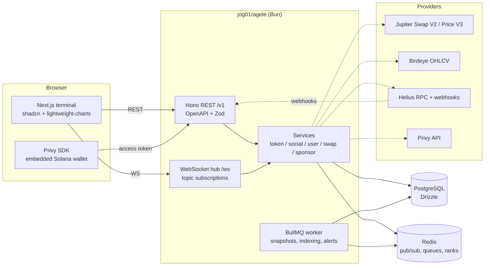
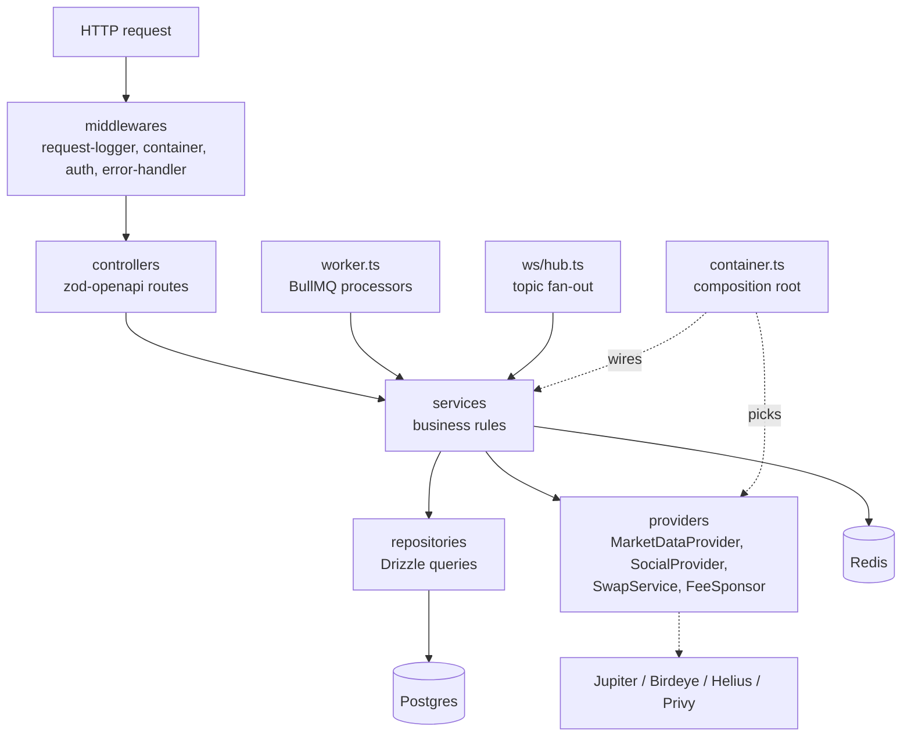
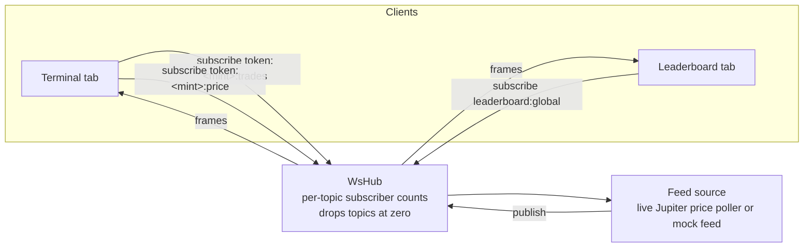

# Architecture (v0.1)

Agele is a social trading terminal for Solana spot markets, quoted in USDC. Code lives in two repos: this one (backend: REST, WebSocket, jobs, docs) and [jog01/agele-web](https://github.com/jog01/agele-web) (Next.js frontend). The product name lives in one constant in agele-web: `src/lib/config.ts` (`PRODUCT_NAME`).

## Tech stack

| Layer                            | Choice                                                                                                   | Why                                                                    |
| -------------------------------- | -------------------------------------------------------------------------------------------------------- | ---------------------------------------------------------------------- |
| Runtime / package manager        | Bun 1.4; two repos, each a plain single package (no monorepo tooling)                                    | Fast installs, native TS, built-in test runner and WebSocket server    |
| API                              | Hono + `@hono/zod-openapi`, Scalar docs at `/docs`                                                       | Typed routes, one Zod schema drives validation and the OpenAPI spec    |
| Validation                       | Zod (API, env, frontend env via `@t3-oss/env-nextjs`)                                                    | One validation library everywhere                                      |
| ORM / DB                         | Drizzle ORM + PostgreSQL 17 (`postgres` driver), SQL migrations in `sql/migrations`                      | SQL-first, typed, migrations are plain reviewable SQL                  |
| Cache / realtime fan-out / ranks | Redis 7 (`ioredis`)                                                                                      | Pub/sub, rate limits, leaderboard sorted sets                          |
| Jobs                             | BullMQ (`src/worker.ts`)                                                                                 | Redis-backed retries and schedules for snapshots, indexing, alerts     |
| Observability                    | OpenTelemetry (OTLP, `@hono/otel`), Pino structured logs with secret redaction, Jaeger in docker-compose | Vendor-neutral traces from day one                                     |
| Frontend                         | Next.js 16 (App Router, Turbopack, Cache Components), React 19                                           | Same framework Arbital uses; streaming + partial prerendering          |
| UI                               | shadcn/ui (Radix), Tailwind v4, Graphite/Ice dark theme                                                  | Owned components, consistent tokens                                    |
| Charts                           | TradingView `lightweight-charts` v5                                                                      | Small, fast, attribution kept visible                                  |
| Client data                      | TanStack Query + `openapi-fetch` with types generated from the API's OpenAPI spec; Zustand for UI state  | No hand-written API types; WS updates merge into the query cache       |
| Auth / wallets                   | Privy (`@privy-io/react-auth`, `@privy-io/node`), embedded Solana wallets                                | Email/Google login, non-custodial embedded wallet, no seed phrases     |
| Solana                           | `@solana/kit` (not web3.js v1), Helius RPC + webhooks                                                    | Modern tree-shakable SDK; Helius for indexing                          |
| Swaps / prices                   | Jupiter Swap V2 (our own fee payer), Jupiter Price V3, Birdeye OHLCV                                     | Best routing; sponsored network fees                                   |
| Tooling                          | Biome (format + lint), `bun test` (API), Vitest (web), GitHub Actions CI                                 | One fast tool for format and lint                                      |
| Rust                             | Not in v0.1                                                                                              | Nothing CPU-bound yet; revisit for a custom indexer or matching engine |

## System diagram



Dotted edges are provider seams. Market data defaults to live keyless Jupiter;
Birdeye candles/trades require a key (503 otherwise). Deterministic mock market
data remains opt-in. See [market-data flows](flows.md#market-data).

## Backend layout (`src/`, this repo)




| Folder          | Role                                                                                                                                 |
| --------------- | ------------------------------------------------------------------------------------------------------------------------------------ |
| `config/`       | Zod-validated env (`env.ts`); the process fails fast on bad config                                                                   |
| `controllers/`  | Hono OpenAPI routes; parse input, call a service, shape output. No business logic                                                    |
| `services/`     | Business logic. Provider seams: `market-data/provider.ts`, `social/provider.ts`, `trading/swap.service.ts`, `sponsor/fee-sponsor.ts` |
| `repositories/` | Database access per aggregate (Drizzle queries)                                                                                      |
| `models/`       | Drizzle table definitions: users, tokens, trades, positions, portfolio snapshots, follows, comments                                  |
| `schemas/`      | Zod DTOs shared by controllers and the OpenAPI spec                                                                                  |
| `middlewares/`  | Request logging, container injection, Privy bearer auth, error envelope                                                              |
| `ws/`           | WebSocket hub, topic grammar, mock live feed                                                                                         |
| `jobs/`         | BullMQ queues and processors (`portfolio-snapshot`)                                                                                  |
| `lib/`          | Logger, telemetry, Redis, errors, PRNG                                                                                               |
| `container.ts`  | Composition root: the only place concrete providers are chosen                                                                       |

Tests in `test/` build the app from `createApp(container)` with fakes. Indexing,
portfolio and snapshot integration tests use migrated PostgreSQL; leaderboard
storage also has an isolated real Redis integration test.

## Indexing and derived ranks

```mermaid
sequenceDiagram
  participant H as Helius enhanced ANY
  participant A as POST /v1/webhooks/helius
  participant P as Pure delta parser
  participant DB as PostgreSQL
  participant L as LeaderboardService
  participant R as Redis
  participant W as WsHub / client
  H->>A: Array + exact Authorization secret
  A->>DB: Resolve linked Solana wallets
  A->>P: Parse per-wallet token and quote deltas
  P-->>A: Buy/sell candidates
  loop Each trade, one transaction
    A->>DB: Ensure token; INSERT trade ON CONFLICT (signature,userId)
    alt New trade
      A->>DB: Update average-cost position; commit
      A->>L: onTrade(userId)
      L->>DB: Read trades and open positions
      L->>R: Atomic score + stats per window
      L->>W: leaderboard:global {window,updatedAt}
    else Duplicate
      DB-->>A: No position change
    end
  end
  A-->>H: 200 {indexed,skipped}
  W->>A: Refetch GET /v1/leaderboard
  Note over L,R: API startup + 60s full rebuild ages out trades and reprices holdings
```

`LeaderboardStore` separates Redis storage from ranking math; PostgreSQL is the
source of truth. Full rebuilds replace all three windows inside one Redis MULTI.
User updates and rebuilds serialize within one API process. The API owns the
trade listener, timer and local WS hub. Multiple API replicas need distributed
update coordination and WS fan-out; they are not implemented here.

`HELIUS_WEBHOOK_SECRET` selects indexed rankings; unset selects mock rankings.
The unchanged leaderboard JSON is accompanied by `X-Data-Source: indexed|demo`,
exposed through CORS. Comments still use the mock provider. Price-provider mode
is independent: production should use live market data. Portfolio valuation is
shared with the daily BullMQ snapshot processor, which builds its own dependencies.

## Frontend layout (jog01/agele-web `src/`)

| Folder                 | Role                                                                                 |
| ---------------------- | ------------------------------------------------------------------------------------ |
| `app/`                 | Routes: `/` landing, `/trade/[mint]` terminal, `/feed`, `/leaderboard`, `/portfolio` |
| `components/terminal/` | Explorer, asset summary, chart, activity/thesis, order ticket, quote review, search  |
| `components/shell/`    | Top bar, status strip, mobile nav, app shell                                         |
| `components/auth/`     | Optional Privy provider; demo auth when no app ID is set                             |
| `lib/api/`             | Generated OpenAPI types (`schema.d.ts`), typed client, query options                 |
| `lib/realtime.ts`      | Multiplexed WebSocket client with backoff + resubscribe                              |
| `stores/`              | Zustand: terminal prefs (persisted), realtime status                                 |

Desktop terminal is `264px explorer | flexible chart | 320px order rail`; below `md` it becomes one column with bottom navigation and a Buy/Sell bar that opens the order ticket in a sheet.

## WebSocket topics



Topic grammar is validated (`ws/topics.ts`); unknown or malformed topics are rejected, and the feed only publishes to topics with at least one subscriber.

## Ownership seams for follow-up work

- **Onchain backend owner:** extend market coverage, historical pricing and backfill; implement `SwapService` (Jupiter Swap V2 quote/build/submit). Enhanced webhook indexing now writes `trades`/`positions` inline.
- **Security owner:** implement `FeeSponsor.cosign` (program allowlist, payer-position checks, compute and lamport caps, simulation, per-user quotas, replay protection). Nothing else holds the fee-payer key.
- **Social:** Redis rankings are implemented (`leaderboard:<window>`); comments still need a real `token_comments` provider.
