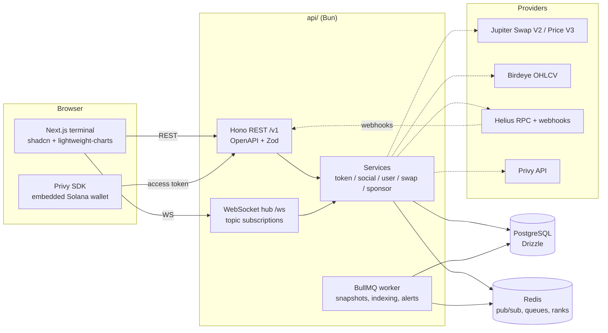

# Architecture (v0.1)

`relay` is a working name for a social trading terminal for Solana spot markets, quoted in USDC. The product name lives in one constant: `web/src/lib/config.ts` (`PRODUCT_NAME`).

## Tech stack

| Layer | Choice | Why |
| --- | --- | --- |
| Runtime / package manager | Bun 1.4 (two plain packages, `api/` and `web/`, no monorepo tooling) | Fast installs, native TS, built-in test runner and WebSocket server |
| API | Hono + `@hono/zod-openapi`, Scalar docs at `/docs` | Typed routes, one Zod schema drives validation and the OpenAPI spec |
| Validation | Zod (API, env, frontend env via `@t3-oss/env-nextjs`) | One validation library everywhere |
| ORM / DB | Drizzle ORM + PostgreSQL 17 (`postgres` driver), SQL migrations in `api/sql/migrations` | SQL-first, typed, migrations are plain reviewable SQL |
| Cache / realtime fan-out / ranks | Redis 7 (`ioredis`) | Pub/sub, rate limits, leaderboard sorted sets |
| Jobs | BullMQ (`api/src/worker.ts`) | Redis-backed retries and schedules for snapshots, indexing, alerts |
| Observability | OpenTelemetry (OTLP, `@hono/otel`), Pino structured logs with secret redaction, Jaeger in docker-compose | Vendor-neutral traces from day one |
| Frontend | Next.js 16 (App Router, Turbopack, Cache Components), React 19 | Same framework Arbital uses; streaming + partial prerendering |
| UI | shadcn/ui (Radix), Tailwind v4, Graphite/Ice dark theme | Owned components, consistent tokens |
| Charts | TradingView `lightweight-charts` v5 | Small, fast, attribution kept visible |
| Client data | TanStack Query + `openapi-fetch` with types generated from the API's OpenAPI spec; Zustand for UI state | No hand-written API types; WS updates merge into the query cache |
| Auth / wallets | Privy (`@privy-io/react-auth`, `@privy-io/node`), embedded Solana wallets | Email/Google login, non-custodial embedded wallet, no seed phrases |
| Solana | `@solana/kit` (not web3.js v1), Helius RPC + webhooks | Modern tree-shakable SDK; Helius for indexing |
| Swaps / prices | Jupiter Swap V2 (our own fee payer), Jupiter Price V3, Birdeye OHLCV | Best routing; sponsored network fees |
| Tooling | Biome (format + lint), `bun test` (API), Vitest (web), GitHub Actions CI | One fast tool for format and lint |
| Rust | Not in v0.1 | Nothing CPU-bound yet; revisit for a custom indexer or matching engine |

## System diagram

Dotted edges are provider seams; v0.1 ships deterministic mock providers behind the same interfaces, so the app runs with no API keys.

## Backend layout (`api/src`)

| Folder | Role |
| --- | --- |
| `config/` | Zod-validated env (`env.ts`); the process fails fast on bad config |
| `controllers/` | Hono OpenAPI routes; parse input, call a service, shape output. No business logic |
| `services/` | Business logic. Provider seams: `market-data/provider.ts`, `social/provider.ts`, `trading/swap.service.ts`, `sponsor/fee-sponsor.ts` |
| `repositories/` | Database access per aggregate (Drizzle queries) |
| `models/` | Drizzle table definitions: users, tokens, trades, positions, portfolio snapshots, follows, comments |
| `schemas/` | Zod DTOs shared by controllers and the OpenAPI spec |
| `middlewares/` | Request logging, container injection, Privy bearer auth, error envelope |
| `ws/` | WebSocket hub, topic grammar, mock live feed |
| `jobs/` | BullMQ queues and processors (`portfolio-snapshot`) |
| `lib/` | Logger, telemetry, Redis, errors, PRNG |
| `container.ts` | Composition root: the only place concrete providers are chosen |

Tests in `api/test` build the app from `createApp(container)` with fakes, so routes are tested without network or DB.

## Frontend layout (`web/src`)

| Folder | Role |
| --- | --- |
| `app/` | Routes: `/` landing, `/trade/[mint]` terminal, `/feed`, `/leaderboard`, `/portfolio` |
| `components/terminal/` | Explorer, asset summary, chart, activity/thesis, order ticket, quote review, search |
| `components/shell/` | Top bar, status strip, mobile nav, app shell |
| `components/auth/` | Optional Privy provider; demo auth when no app ID is set |
| `lib/api/` | Generated OpenAPI types (`schema.d.ts`), typed client, query options |
| `lib/realtime.ts` | Multiplexed WebSocket client with backoff + resubscribe |
| `stores/` | Zustand: terminal prefs (persisted), realtime status |

Desktop terminal is `264px explorer | flexible chart | 320px order rail`; below `md` it becomes one column with bottom navigation and a Buy/Sell bar that opens the order ticket in a sheet.

## Ownership seams for follow-up work

- **Onchain backend owner:** implement `MarketDataProvider` (Jupiter Price V3 + Birdeye), `SwapService` (Jupiter Swap V2 quote/build/submit) and a Helius webhook controller that writes `trades`/`positions`. Swap the mocks in `container.ts`.
- **Security owner:** implement `FeeSponsor.cosign` (program allowlist, payer-position checks, compute and lamport caps, simulation, per-user quotas, replay protection). Nothing else holds the fee-payer key.
- **Social:** implement `SocialProvider` on Redis sorted sets (`lb:{window}`) and the `token_comments` table.
