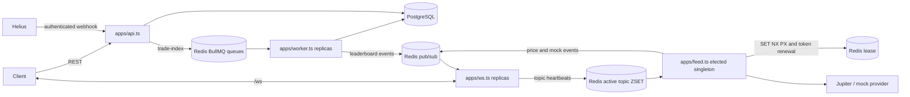
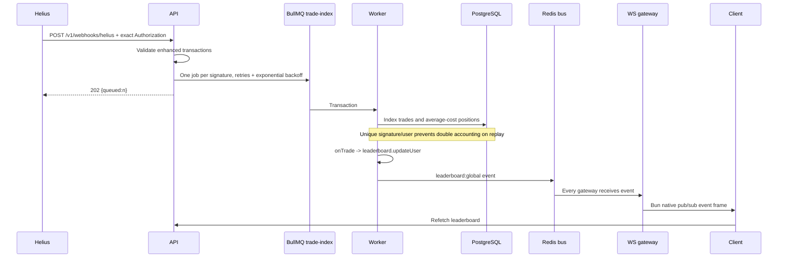

# Architecture

Agele is one Bun/TypeScript codebase deployed as four processes, sharing services,
repositories, schemas and a PostgreSQL database. This is not a microservice split.

## Webhook to client

## Ownership and shared code

- `apps/api.ts`: Hono REST only; service composition in `container.ts`. Events
  use an EventPublisher interface, not WsHub. Tests can inject an in-memory publisher.
- `apps/ws.ts`: owns WsHub and Bun upgrades, GET /health; no database or API container.
  Publisher and subscriber use dedicated ioredis connections. Redis pub/sub is
  ephemeral, not a replay log: reconnecting clients should refetch REST state.
- `apps/worker.ts`: builds only indexing/ranking dependencies. BullMQ
  upsertJobScheduler registers one leaderboard rebuild every 60 seconds and one
  daily portfolio snapshot (00:05 UTC) across replicas. Trade listeners stay wired.
- `apps/feed.ts`: builds only market-data dependencies. Polls active allowlisted
  price topics (or mock trades/prices) and publishes through Redis.
- `services/`, `repositories/`, `schemas/` remain shared. PostgreSQL is the source
  of truth; Redis holds leaderboard projections, jobs and realtime routing.

Gateway heartbeats refresh replica/topic ZSET members every 3 seconds, with a
15-second expiry score. Dead or unsubscribed topics disappear within 15 seconds;
the feed prunes expired members when reading. Multiple gateways subscribing to
the same topic retain it until the last live heartbeat expires.

The feed holds a token-owned 15-second Redis lease, renewed every 3 seconds.
Other replicas remain idle and retry acquisition. Each topic read/publication also
checks ownership; renewal failure stops the local feed. Lease release compares
the token so an old owner cannot delete a successor's lease.

## Operational semantics and limits

HELIUS_WEBHOOK_SECRET enables the Redis leaderboard projection; without it,
rankings read PostgreSQL directly and scheduled rebuilds are no-ops. See
[social store](social.md) for source labels and seed behavior. Trade-index
jobs keep completed signatures for 7 days and failed ones for 30 days for dedupe
and diagnosis. Retries are at-least-once; PostgreSQL uniqueness prevents duplicate
position mutations. Listener errors are logged by TradeIndexer; the next periodic
rebuild repairs missed leaderboard updates. Rebuild and user updates serialize
inside a worker, not across worker replicas; Redis projections are eventually
consistent. Redis pub/sub is deliberately best effort.

Only the implemented leaderboard rebuild and portfolio snapshot are scheduled.
There is no reconciliation/backfill/alert sweep: such work requires a defined
source of truth, replay range and idempotency contract before adding a processor.

Migrations are a one-off `bun run db:migrate` deployment job, completed before
starting the four processes, never another long-running process. See README for
local and Docker commands. Frontend lives in jog01/agele-web and already reads a
separate NEXT_PUBLIC_WS_URL; point it at the gateway, not the REST port.
