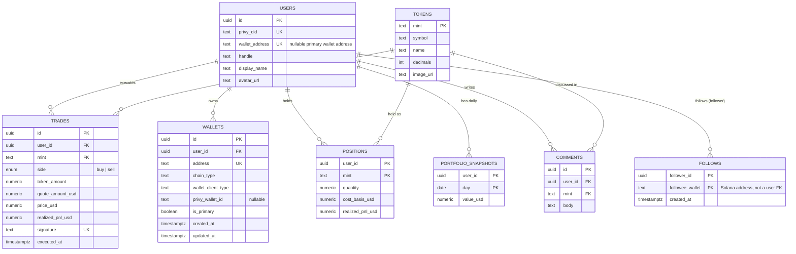
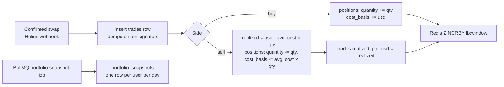

# Data model

PostgreSQL schema managed by Drizzle (`src/models/`, migrations in `sql/migrations/`). Amounts are `numeric(38,18)` so token quantities and USD values never lose precision.



## How a fill updates the tables



Redis holds derived, rebuildable state only: leaderboard sorted sets (`lb:24h`, `lb:7d`, `lb:30d`), WebSocket fan-out channels and BullMQ queues.

## Wallet follows and feed

`follows` has a composite primary key `(follower_id, followee_wallet)` and an index on `followee_wallet`. The follower references `users.id` with cascade deletion; the target need not be registered. Existing user-target follows migrate to the target's primary `wallet_address`; targets without a primary wallet cannot be represented and are omitted. PUT and DELETE are idempotent. Following any of the viewer's stored wallets is rejected.

```mermaid
sequenceDiagram
  participant API
  participant Users
  participant Follows as FollowRepository
  participant Social as SocialProvider
  API->>Users: ensureUser(verified claims)
  Users-->>API: viewer + owned wallets
  API->>Follows: follow(viewer.id, target wallet)
  Note over Follows: PK prevents duplicates; no target user FK
  API->>Follows: listWallets(viewer.id)
  Follows-->>API: followed wallet addresses
  API->>Social: feed(wallets, cursor, limit)
  Social-->>API: items + nextCursor
```

Feed is deterministic demo content until trade indexing lands, not a query over persisted trades/comments yet. Mock wallets are valid Solana addresses stable across leaderboard windows. The cursor encodes `(createdAt, id)` in base64url; both keys sort descending, with an exclusive boundary. Timestamps are integer Unix seconds. Anonymous leaderboard entries omit `isFollowing`; verified viewers receive a boolean per wallet.
