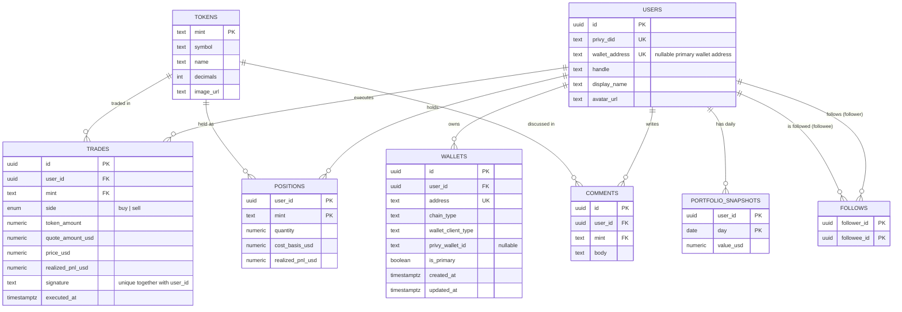
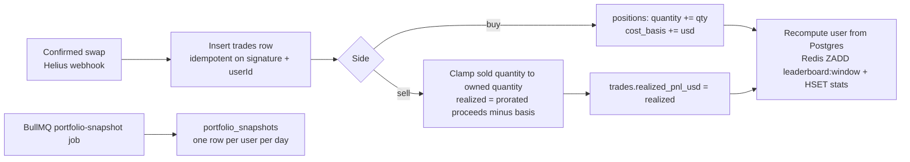

# Data model

PostgreSQL schema managed by Drizzle (`src/models/`, migrations in `sql/migrations/`). Amounts are `numeric(38,18)` so token quantities and USD values never lose precision.

## How a fill updates the tables

Redis holds derived, rebuildable leaderboard state and BullMQ queues. For each
`w` in `24h|7d|30d`, `leaderboard:<w>` is a ZSET (member `userId`, score `pnlUsd`)
and `leaderboard:<w>:stats` is a hash (`userId` → JSON `{volumeUsd,trades,winRatePct,pnlPct}`).
Updates are absolute recomputations, not increments, so retries cannot double-count.
Full rebuild uses one MULTI to delete/repopulate all window keys, including empty
windows. The current WS fan-out is local to the API process, not Redis pub/sub.

`trades` has composite uniqueness `(signature,user_id)` so one Solana transaction
can index different linked users. Positions remain per user/mint. Decimal arithmetic
for persisted trade/position updates uses 18-place bigint fixed point; API/derived
rank values are JSON numbers. `portfolio_snapshots` is keyed by `(user_id,day)`;
today's sweep is an upsert, not an accumulating series.
