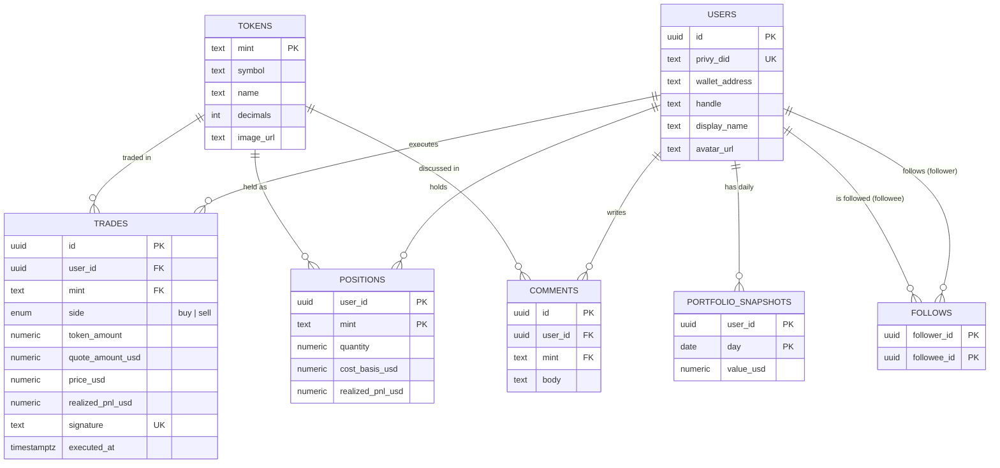
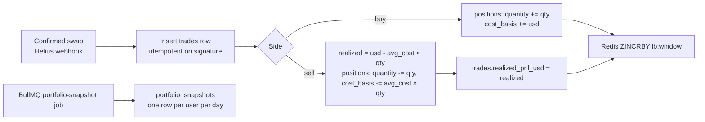

# Data model

PostgreSQL schema managed by Drizzle (`src/models/`, migrations in `sql/migrations/`). Amounts are `numeric(38,18)` so token quantities and USD values never lose precision.

## How a fill updates the tables

Redis holds derived, rebuildable state only: leaderboard sorted sets (`lb:24h`, `lb:7d`, `lb:30d`), WebSocket fan-out channels and BullMQ queues.
