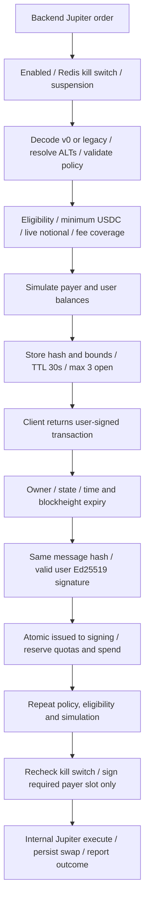

# Fee-payer security policy

Status: v0.1 policy, binding for the backend fee-payer service.
Owner: onchain security.
Applies to: every transaction the backend signs with the fee-payer key (gasless Jupiter Swap V2 swaps and gasless withdrawals).
Implemented by: `ValidatedFeeSponsor` (`src/services/sponsor/validated-fee-sponsor.ts`), behind the `FeeSponsor` interface (`src/services/sponsor/fee-sponsor.ts`), the only code that holds the fee-payer key. Caller: `SwapService` (`src/services/trading/swap.service.ts`). Withdrawals remain disabled.

## 1. Threat model

Agele runs a backend-owned **fee-payer hot wallet** that pays signature fees, priority fees and rent for user transactions. Users sign with their Privy embedded wallet; the backend co-signs as fee payer and broadcasts.

A fee-payer signature authorizes **every** instruction in the transaction that lists the fee payer as a signer, including through CPI. Whoever controls what the fee payer signs controls its balance. The policy below exists to make the following true:

> The fee payer only ever signs a message the backend built itself, that passed every check in §3, for an authenticated user within their limits, and the most any single signature can cost us is a small, fixed number of lamports.

Attack vectors covered (numbering from the v0.1 onchain integrations research, §5 "Fee-payer attack vectors"):

| # | Vector | Primary controls |
|---|---|---|
| V1 | Direct drain (transfer from / authority = fee payer) | §2 build-only signing, §3.3 account-role check |
| V2 | Rent farming via ATA create + `CloseAccount` | §3.4 close-account rule, §4 fees |
| V3 | Arbitrary account creation funded by payer | §3.2 program allowlist, §3.4 System rules |
| V4 | Priority-fee inflation | §3.5 fee caps |
| V5 | Failed-tx spam (fees charged on failure) | §3.7 simulation, §4 rate limits, §6 circuit breaker |
| V6 | Signature padding | §3.5 signature cap |
| V7 | Durable-nonce replay / delayed submission | §3.6 blockhash + nonce rules, §2 expiry |
| V8 | Malicious CPI / Token-2022 transfer hooks | §3.2 allowlist, §3.8 token extensions |
| V9 | Fee payer holds value worth stealing | §5 key handling and float |
| V10 | Economic abuse (dust swaps farming gas) | §4 limits and fees |

## 2. Signing flow (non-negotiable)

1. **Build.** The backend builds or fetches every transaction it will co-sign:
   - Swaps: `GET /swap/v2/order` with `taker=<user wallet>` and `payer=<FEE_PAYER>`.
   - Withdrawals: backend assembles the instructions itself (§3.9).
   The client never supplies transaction bytes, instructions, accounts or the fee payer.
2. **Validate.** The backend runs every check in §3 on the built transaction **before** returning it to the client. A failure rejects the request; nothing is stored or signed.
3. **Issue.** The backend stores an *issued-transaction record*: `{ id, userId, wallet, kind (swap|withdraw), requestId (Jupiter), messageHash (sha256 of the serialized message), lastValidBlockHeight, expectedFeeLamports, expectedRentLamports, createdAt, state }`. TTL: **30 seconds** or `lastValidBlockHeight`, whichever comes first. It returns the unsigned transaction to the client.
4. **User signs.** The client signs with Privy `signTransaction` and returns the signed bytes plus the record `id`.
5. **Co-sign.** The backend:
   - loads the record by `id`, requires `state = issued`, not expired, and `userId` equal to the authenticated user;
   - deserializes the returned transaction and requires `sha256(message) == messageHash` (byte-identical message; only signatures may differ);
   - verifies the user's signature is present and valid for the message;
   - atomically moves the record to `state = signing` (compare-and-set) so a record can be co-signed **at most once**;
   - signs with the fee payer **only if the fee payer is a required signer** of the message (match by pubkey; on JupiterZ routes it may not be — then do not sign);
   - submits (`POST /swap/v2/execute` for swaps, Helius RPC / Sender for withdrawals) and records the signature and outcome.
6. **Backend signs last and broadcasts.** A fee-payer-signed transaction never leaves the backend except to the submission endpoint. Partially signed transactions with the fee-payer signature are never returned to the client.

Re-validation: `cosign` re-runs all of §3 on the returned transaction even though the message must be byte-identical to the one validated at issue. The checks are cheap, and this keeps the fee payer safe if the issued-record store is wrong or bypassed.

### 2.1 Code contract (`FeeSponsor`)

```ts
type SponsorKind = "swap" | "withdraw";

interface FeeSponsor {
  readonly feePayer: string;
  /** Steps 2-3: run §3 and §4 on a backend-built tx and store the issued record. Throws SponsorRejectedError. */
  register(transactionBase64: string, context: { userId: string; wallet: string; kind: SponsorKind; requestId: string }): Promise<{ expiresAt: number }>;
  /** Step 5: check the issued record, re-run §3, co-sign. Returns the fully signed tx (base64) for submission only. */
  cosign(transactionBase64: string, context: { userId: string; requestId: string }): Promise<string>;
}
```

- `SwapService.build` calls `register` before it returns the transaction to the client. A rejection means the swap is not offered.
- `SwapService.submit` calls `cosign`, then passes the result to Jupiter `/execute` and nowhere else. It never logs, caches or returns it.
- Rejections throw `SponsorRejectedError` with one stable reason code per check (e.g. `program_not_allowed`, `fee_payer_role`, `fee_cap`, `nonce`, `simulation`, `quota`, `record_expired`, `message_mismatch`, `kill_switch`). The API maps it to `{ error: { code: "sponsor_rejected", message } }`, where `message` names the reason but not the internal limits.
- `container.ts` must wire a `FeeSponsor` that rejects everything with `sponsor_disabled` when no fee-payer key is configured. Demo mode stays "trading disabled"; there is never a mock that signs.
- Config (all via `config/env.ts`): `FEE_PAYER_PUBKEY`, `FEE_PAYER_SECRET` (secret-store reference in prod; raw key only in dev), `SPONSOR_ENABLED` (kill switch, default `false`), and the limits named in §3-§6.

## 3. Transaction validation (all must pass)

Run on the decompiled message. Any check that cannot be evaluated (e.g. an address lookup table fails to load) is a **reject**, never a pass.

### 3.1 Structure
- Versioned (v0) or legacy message only. Any other version: reject.
- **Fee payer is account index 0** and equals `FEE_PAYER` (the configured pubkey for this environment).
- **Resolve all address lookup tables** from chain at a `confirmed` commitment before any account checks; reject if any ALT cannot be fetched or an index is out of range. All checks below run on the fully resolved account list.
- The fee payer must not appear in any lookup table (ALT-loaded accounts cannot be signers, but this also stops it being passed as a writable non-signer to programs).
- Serialized size ≤ 1232 bytes.

### 3.2 Program allowlist
Every top-level instruction's program id must be on the allowlist for the transaction kind. Unknown program: reject.

| Program | Swap | Withdraw |
|---|---|---|
| ComputeBudget `ComputeBudget111111111111111111111111111111` | yes | yes |
| System `11111111111111111111111111111111` (only instructions allowed in §3.4) | yes | no |
| SPL Token `TokenkegQfeZyiNwAJbNbGKPFXCWuBvf9Ss623VQ5DA` | yes | yes |
| Token-2022 `TokenzQdBNbLqP5VEhdkAS6EPFLC1PHnBqCXEpPxuEb` (§3.8) | yes | yes |
| Associated Token Account `ATokenGPvbdGVxr1b2hvZbsiqW5xWH25efTNsLJA8knL` | yes | yes |
| Jupiter Aggregator v6 `JUP6LkbZbjS1jKKwapdHNy74zcZ3tLUZoi5QNyVTaV4` | yes | no |
| JupiterZ / RFQ program(s) returned by V2 `/order` | yes, pinned by pubkey | no |
| Memo (optional) | yes | yes |

- Program ids are **pinned constants in code**, not loaded from Jupiter responses or config the client can influence. Adding a program is a reviewed code change.
- CPIs made by allowlisted programs are not individually inspected at build time; §3.3 (no fee-payer role outside allowed slots) and §3.7 (simulation balance check) are what bound them.

### 3.3 Fee-payer role check (V1, V8)
For every instruction, find every account meta equal to `FEE_PAYER`. Allowed occurrences only:

| Instruction | Allowed fee-payer position |
|---|---|
| ATA `Create` / `CreateIdempotent` | `payer` (account 0) only |
| System `CreateAccount` for the temporary wSOL account | `from` (account 0) only, and only per §3.4 |
| Jupiter v6 route instructions | the `payer` account Jupiter documents for rent of intermediate accounts, if present; never as `user_transfer_authority` / source owner |

Anywhere else — as a token authority, owner, source, delegate, close destination's *signer*, or as any account of an instruction from a program not listed above — reject. Also reject if the fee payer's account index is referenced by a program not in §3.2 (defense in depth even though §3.2 already rejects them).

The fee payer must never be the owner/authority of any token account in the transaction, and the transaction must not create a token account owned by the fee payer.

### 3.4 Instruction rules
- **System program**: only `CreateAccount` (for temporary wSOL) with `space == 165`, `owner == SPL Token`, `lamports ≤ rent-exempt minimum for 165 bytes`, or `Transfer` where `from` is the **user** wallet (wrapping their own SOL). Reject `Transfer`/`TransferWithSeed` from the fee payer, `Assign`, `Allocate*`, `CreateAccountWithSeed` with large space, and all nonce instructions (§3.6).
- **ATA create**: `payer == FEE_PAYER` is allowed only if `owner` is the user wallet (swap) or the withdrawal destination (withdraw). At most **2** ATA creates per swap, **1** per withdrawal.
- **CloseAccount (V2)**: allowed only when the account is a temporary wSOL account created in the same transaction. Its rent destination must be either `FEE_PAYER` (we get back what we paid) or the user if the account was funded by the user. Any `CloseAccount` on an account whose rent the fee payer paid with destination ≠ `FEE_PAYER`: reject. Persistent ATAs we fund are never closed in a sponsored transaction.
- **Token transfers** (`Transfer`, `TransferChecked`): authority must be the user wallet. For withdrawals see §3.9.
- **Approve / SetAuthority / Revoke / FreezeAccount / ThawAccount / InitializeMint / MintTo / Burn**: reject in sponsored transactions.

### 3.5 Fee and signature caps (V4, V6)
- **Required signatures ≤ 2** (fee payer + user). Swaps on routes that need a third signer (e.g. JupiterZ market maker) are allowed up to **3** only if the extra signer is not the fee payer and the route is JupiterZ. Anything else: reject.
- **Exactly one** `SetComputeUnitLimit` and at most one `SetComputeUnitPrice`; duplicates reject.
- `computeUnitLimit ≤ 1,400,000`.
- `computeUnitPrice ≤ MAX_CU_PRICE_MICROLAMPORTS` (config, default **2,000,000** µlamports/CU; tuned from observed Jupiter values).
- **Total fee the payer can lose for one transaction**:
  `signatures × 5,000 + ceil(cuLimit × cuPrice / 1e6) + rent paid by payer for new accounts`
  must be ≤ `MAX_LAMPORTS_PER_TX` (config, default **10,000,000** lamports = 0.01 SOL). This number is stored as `expectedFeeLamports + expectedRentLamports` on the issued record.
- Jito tips or any other lamport transfer from the fee payer: reject (Jupiter `/execute` handles landing).

### 3.6 Lifetime (V7)
- Transaction must use a **recent blockhash**. If the first instruction is `AdvanceNonceAccount`, or any instruction is a System nonce instruction: reject.
- The blockhash must be valid when checked (`isBlockhashValid` or `lastValidBlockHeight` from the order response); records expire per §2.
- The backend never co-signs a record after expiry, even if the blockhash would still land.

### 3.7 Simulation (V5, CPI backstop)
- Simulate with `sigVerify: false`, `replaceRecentBlockhash: false`, commitment `processed`, requesting post-state for `FEE_PAYER`.
- Reject if simulation errors.
- Reject if the fee payer's SOL balance delta is more negative than `expectedFeeLamports + expectedRentLamports` (minus any expected rent refund to the payer).
- Reject if any token account owned by the fee payer changes (there should be none).
- Simulation is a backstop, not a substitute for §3.1–3.6; state can change between simulation and landing.

### 3.8 Tokens and Token-2022 (V8)
- Swaps are limited to a **mint allowlist** for v0.1 (USDC, SOL/wSOL and the listed blue chips). Unknown mint: reject. Expanding to arbitrary tokens requires revisiting this section.
- For Token-2022 mints, reject if the mint has any of: `TransferHook`, `PermanentDelegate`, `TransferFeeConfig` with non-zero fee (unless explicitly allowlisted), `ConfidentialTransfer`, `DefaultAccountState = Frozen`, `NonTransferable`. Read extensions from chain, cache per mint with short TTL.

### 3.9 Withdrawal safety
- Instructions, in order: compute budget, optional `CreateIdempotent(payer=FEE_PAYER, owner=destination, mint)`, `TransferChecked(source = user ATA, destination = destination ATA, authority = user, mint, decimals)`, optional `TransferChecked(user → treasury, withdraw fee)`. Nothing else.
- Destination must be a valid on-curve base58 pubkey (off-curve/PDA destinations rejected for v0.1), not `FEE_PAYER`, not the treasury, not the user's own wallet.
- If the destination ATA does not exist, the withdraw fee must cover its rent (§4).
- The destination account, if it exists, must be owned by the System program (a wallet). Reject token accounts, mints, program accounts and PDAs: sending to them usually loses funds.
- Mint must be on the withdrawal allowlist (USDC for v0.1). The amount must be ≤ the user's balance as read from chain at issue time.
- The client shows the full destination address, mint and amount, plus the fee, in an explicit confirm step. The backend never fills in a destination the user did not type or paste.
- Large withdrawals (≥ `WITHDRAW_MFA_THRESHOLD_USD`, default $1,000) require Privy MFA re-verification before the backend issues the transaction.
- Limits: 5 withdrawals and $10,000 per user per day (`WITHDRAW_DAILY_COUNT`, `WITHDRAW_DAILY_USD`). Withdrawals to a destination first used in the last 24 h are capped at $1,000 until then.
- Simulation (§3.7) also checks the user side: only the user's withdrawal mint balance decreases, by exactly `amount + fee`.

### 3.10 Swap safety (`SwapService`)
These protect the user, not the fee payer, and run in `SwapService.build` on the Jupiter `/order` response before `register`:
- The `/order` response must match the request: `inputMint`, `outputMint` and `inAmount` equal what the user asked for; `taker` equals the user's wallet. V2 has no single response `payer` field: `rentFeePayer` and any `prioritizationFeePayer` equal `FEE_PAYER`; `signatureFeePayer` also equals it except on JupiterZ, where it may differ but must not be the taker. Any mismatch: reject. Transaction role checks still run independently.
- Both mints are on the v0.1 allowlist (§3.8).
- `slippageBps ≤ MAX_SLIPPAGE_BPS` (default 300; the client default is 50). Reject a price impact above `MAX_PRICE_IMPACT_PCT` (default 3%).
- The review dialog shows receive, minimum receive (`otherAmountThreshold`), fees, price impact, destination mint and expiry from this same `/order` response. A new quote means a new `requestId` and a new user signature.
- Simulation (§3.7) also checks the user side: the user's input-mint balance decreases by at most `inAmount` (plus any wSOL wrap). The output-mint balance in the user's own ATA increases by at least `otherAmountThreshold`. No other user token balance decreases.
- `submit` accepts only a `requestId` issued to the same user, at most once. The swap row is written from the `/execute` response, idempotent on signature; indexing owns subsequent trade/PnL rows.

## 4. Limits and economics (V5, V10)

Defaults below are config, owned by this policy; changing a default is a PR touching this doc.

| Limit | Default | Scope |
|---|---|---|
| Sponsorship eligibility | Authenticated Privy user with verified access token; wallet mapped in DB | per request |
| Minimum USDC balance before any sponsored tx | $5 | per user |
| Minimum swap size | $5 notional | per swap |
| Minimum withdrawal | $5 | per withdrawal |
| `/trades/quote` issue rate | 30 / min | per user, and per IP |
| Sponsored transactions | 10 / min, 200 / day | per user |
| Sponsored lamports | 0.05 SOL / day | per user |
| Failed sponsored transactions | 5 in 10 min ⇒ sponsorship suspended 1 h | per user |
| Open issued records | 3 | per user |
| Withdraw fee | flat $0.50 USDC, plus destination ATA rent if created | per withdrawal |
| Referral fee (`referralFee`) | set so expected fee revenue ≥ expected gas + rent per swap | per swap |

- Rate limits are enforced in Redis with the user id as key; IP limits additionally for quote issuance.
- Users over a limit get a clear error; the backend never falls back to signing without limits.
- Swaps where Jupiter's `/order` response would make the fee payer pay rent for more than 2 accounts are rejected (V2/V3).

## 5. Key handling (V9)

- **One fee-payer key per environment** (dev, staging, prod). Prod key is never used in other environments or on developer machines.
- Storage: prod key in a managed secret store / KMS (or a Privy server wallet / KMS-backed signer if adopted), injected only into the fee-payer service. Never in the repo, client bundle, logs, error messages, or analytics. Plain env var is acceptable for dev only.
- **Process isolation**: only the co-sign step can call the signer; it exposes a single `signIssued(recordId)` path, not a generic "sign these bytes" function.
- **The fee payer holds only SOL.** No SPL tokens, no mint/freeze/upgrade/referral/treasury authority, no stake, no other roles. Referral fee accounts and the treasury use separate keys.
- **Float**: hot balance kept at `FEE_PAYER_TARGET_SOL` (default 2 SOL; roughly one day of expected spend). A top-up job moves SOL from a **cold treasury** (multisig or hardware-held, never on the backend) when balance < `FEE_PAYER_MIN_SOL` (default 0.5 SOL), capped at `FEE_PAYER_MAX_TOPUP_SOL_PER_DAY`. Top-up requires a human or a separately keyed signer; the fee-payer key can never pull from the treasury.
- **Rotation**: rotate the fee-payer key at least every 90 days and immediately on suspected compromise; the service must support a new key via config without code change. On rotation, sweep the remaining SOL from the old key to the treasury.

## 6. Monitoring and response

Emit metrics and structured logs (no secrets, no full signed transactions; message hash + signature only) for:

- Every issue / reject / co-sign / submit / land / fail, with reject reason code (one code per §3 check).
- Fee-payer SOL balance (poll ≤ 30 s and via Helius webhook on the fee-payer address).
- **Per-transaction balance delta**: landed delta vs. `expectedFeeLamports + expectedRentLamports`. Any landed transaction exceeding expected by > 0 lamports: page.
- Any fee-payer debit not matching a co-signed record (a signature we did not issue, or a transfer out): page — this means key compromise.
- Spend per user per day, and top spenders.

Alerts:

| Condition | Action |
|---|---|
| Unknown outgoing fee-payer transaction | Page; **automatic kill switch**; rotate key |
| Hourly spend > 3× trailing 7-day hourly average, or > `DAILY_SPEND_CAP_SOL` (default 1 SOL) per day | **Circuit breaker**: stop co-signing; page |
| Balance < `FEE_PAYER_MIN_SOL` and top-up failed | Page |
| Reject rate spike for one user / IP | Auto-suspend sponsorship for that user; alert |
| Landed tx delta > expected | Page; suspend sponsorship for that route/kind |

**Kill switch**: a single config flag / Redis key that makes the co-sign step reject everything. Users see "trading temporarily unavailable". Turning it back on is a manual action.

Incident runbook (minimum): flip kill switch → move remaining SOL to treasury with the old key → rotate key → find the signed transaction(s) and the failed check → fix with a test reproducing it → re-enable.

## 7. Testing requirements for the implementation PR

The `FeeSponsor`/`SwapService` PRs must include unit tests that build each of these transactions and show they are **rejected** before signing:

1. System transfer from the fee payer (top-level), and fee payer as token transfer authority.
2. Fee payer passed as an extra signer/writable account to an allowlisted program in a non-allowed slot.
3. ATA created by the fee payer and closed in the same tx with destination = user.
4. `CreateAccount` funded by the fee payer with `space` ≠ 165 or owner ≠ Token.
5. `SetComputeUnitPrice` above the cap; total fee above `MAX_LAMPORTS_PER_TX`; duplicate compute budget instructions.
6. More signatures than allowed.
7. `AdvanceNonceAccount` first instruction.
8. Instruction from a program not on the allowlist (including via an address lookup table).
9. Token-2022 mint with a transfer hook / permanent delegate.
10. Client-returned transaction whose message differs from the issued one by one byte; reused record id; expired record; record id belonging to another user.

11. Swap whose `/order` response differs from the request (mint, amount, taker or payer); slippage or price impact above the cap; a simulated user balance change outside §3.10.
12. Withdrawal to a token account, mint or PDA; over the daily limit; simulated user debit ≠ `amount + fee`.

Plus one positive test per kind (swap via a recorded `/order` fixture, withdrawal with and without ATA creation) that passes and is signed exactly once.

## Implementation map

| Policy | Implementation |
|---|---|
| §2 / §2.1 issued identity, owner, TTL, user Ed25519 signature, CAS, co-sign | `src/services/sponsor/validated-fee-sponsor.ts`, `issued-store.ts` (Redis and in-memory) |
| §3.1–§3.6, §3.8 message/ALT, program and account roles, instructions, fees, signatures, lifetime, mints | `src/services/sponsor/validator.ts`, `programs.ts`, `swap-mints.ts`; injectable `sponsor-rpc.ts` |
| §3.7 / §3.10 payer and user balance simulation | `validated-fee-sponsor.ts` (`simulate`), `sponsor-rpc.ts` |
| §3.10 order response constraints and execution persistence | `src/services/trading/swap.service.ts`, `jupiter-swap.client.ts`, `src/repositories/swap.repository.ts`; swap rows are authoritative, later indexing owns trades/PnL |
| §4 user quota, open records, suspension, daily spend circuit breaker / Redis kill switch | `issued-store.ts`; transaction counts and maximum fee/rent are reserved atomically at CAS, conservatively charged even if simulation/execution fails |
| §4 minimum balance/notional and estimated fee coverage | `validated-fee-sponsor.ts` (`eligibility`), injected live market data and RPC token balances; unavailable prices fail closed |
| §5 development key loading and pubkey equality; co-sign-only signing | `validated-fee-sponsor.ts` (`ready`, `cosign`); `src/index.ts` awaits initialization before serving; `src/config/env.ts` prohibits raw secret outside development |
| §6 structured issue/reject/co-sign/outcome logs and low-cardinality OTel event counter | `validated-fee-sponsor.ts`, outcome callback in `swap.service.ts` |
| §7 adversarial transaction tests | `test/fee-sponsor.test.ts`, `sponsor-store.test.ts`, `sponsor-rpc.test.ts`, existing `swap.service.test.ts` |



### Restrictions and operational gaps

- The original policy's Jupiter v6 string decoded to **31 bytes**, not a Solana pubkey. The pin above is corrected to Jupiter's [`declare_id!` in the official CPI source](https://github.com/jup-ag/jupiter-cpi/blob/main/src/lib.rs); account schemas/discriminators follow its IDL.
- Only Jupiter v6 `route` and `shared_accounts_route` account schemas are accepted. The source is checked against the user's input token account. The fee payer is not accepted in Jupiter remaining accounts: undocumented intermediate-rent slots cannot safely be inferred. Token instructions, ATA and System payer slots are explicitly checked.
- **JupiterZ is disabled**, including its three-signature exception. The public V2 order docs describe RFQ payer behavior but do not pin a settlement program/account schema. The RFQ Order Engine address from separate RFQ docs is not assumed to be the Swap V2 settlement program. Only the documented JUP6 address is pinned; unknown programs fail closed. This is the permitted fail-closed alternative, not a claim of JupiterZ support.
- Native-SOL output/unwrapping fails closed: the required output increase must be in the user's own ATA. Native-SOL input wrapping into an ATA is also unsupported (System transfers are limited to same-message temporary accounts); already-funded wSOL input can pass. Temporary wSOL using an extra account signer is refused by the two-signature cap. Token-2022 permits metadata-only mint extensions; all transfer/authority-affecting extensions (including zero-fee configurations) are conservatively rejected. All token accounts referenced by the message must use allowlisted mints, so some intermediate routes are rejected.
- `lastValidBlockHeight` is required for issuing. Cosigning checks both the 30-second wall-clock expiry and current height; Redis physically expires unclaimed records at 30 seconds and retains only an ID tombstone for stable `record_expired`. Claimed records retain metadata for one day for at-most-once outcomes; neither store persists transaction bytes or keys.
- Referral settings are sent to Jupiter builds and the response fee must cover the configured requested fee. Eligibility uses the documented 80% integrator share for estimated revenue. Realized referral receipts are **not reconciled** here. Referral project setup and separate treasury authority are operator responsibilities.
- **Not production-ready:** the managed/KMS signer, cold-treasury top-ups, key isolation at the process boundary, periodic fee-payer balance/webhook monitoring, unknown-outgoing-transaction detection, landed-delta reconciliation/paging, reject-spike alerts and trailing-seven-day hourly anomaly breaker are not implemented. The daily reservation cap and manual kill switch are implemented. These operational systems require separate deployment/alerting/indexing integrations; do not enable production sponsorship until they exist. Raw environment secrets remain development-only.
- Unit transactions use real Solana serialization and generated Ed25519 keypairs with deterministic fake chain state/simulation. The positive route is synthetic but follows the Jupiter v6 IDL; no funded mainnet swap or actual pool execution has been performed. Existing order mismatch tests use the recorded preview fixture.

## 8. Out of scope for v0.1 (revisit triggers)

- Sponsoring arbitrary user-built transactions: if needed, run **Kora** as a sidecar with equivalent rules rather than extending this validator.
- Privy signers acting while the user is offline (copy trading, limit orders): separate policy.
- Non-allowlisted / new memecoin mints: §3.8 must be revisited first.
