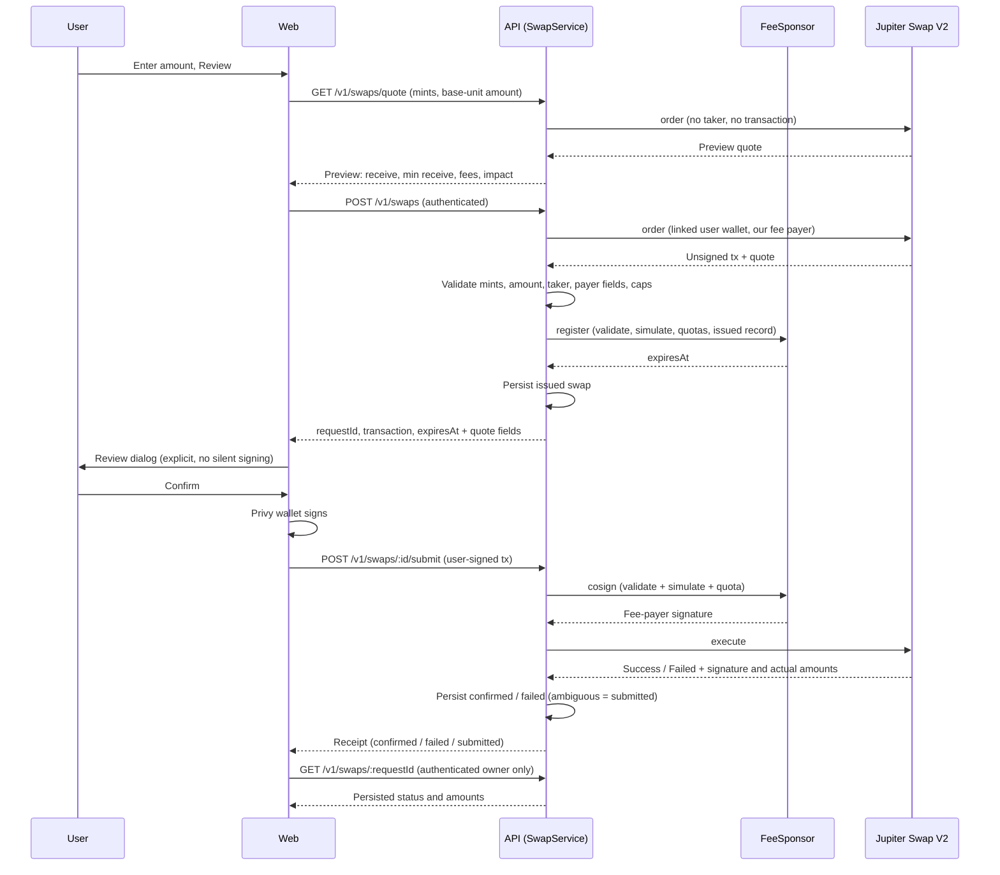
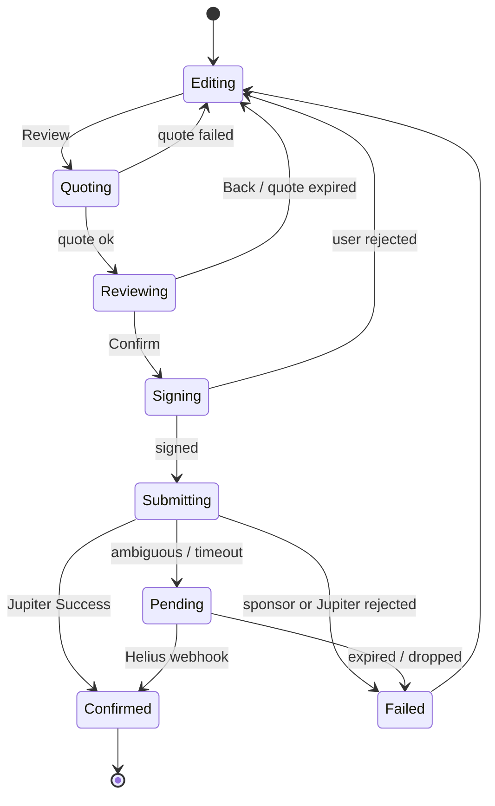
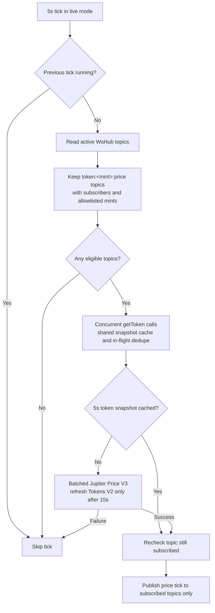
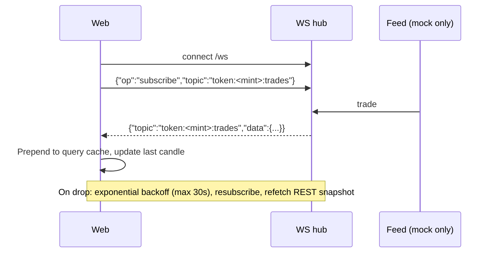
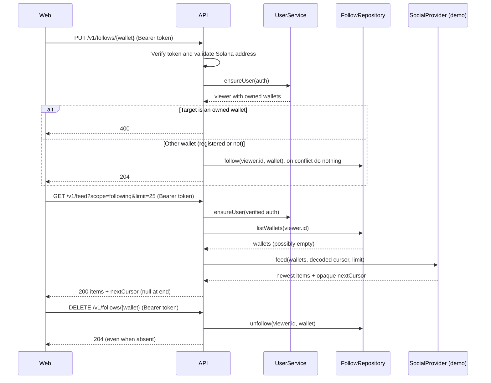

# Flows

## Sign-in and wallet

```mermaid
sequenceDiagram
  participant U as User
  participant W as Web (Privy SDK)
  participant P as Privy
  participant A as API
  U->>W: Sign in (email / Google)
  W->>P: Auth
  P-->>W: Access token + embedded Solana wallet
  W->>A: GET /v1/me (Bearer token)
  alt No PRIVY_APP_ID
    A-->>W: 503 auth_not_configured
  else Auth configured
    A->>A: verifyAccessToken (pinned key or JWKS)
    alt Invalid or expired token
      A-->>W: 401
    else Valid token
      A->>A: Upsert user by Privy DID
      opt walletAddress is null
        alt No PRIVY_APP_SECRET
          Note over A: Wallet linkage disabled; use stored wallets
        else Linkage enabled
          A->>P: Privy API users()._get(did)
          alt Privy lookup succeeds
            P-->>A: Linked accounts
            A->>A: Upsert Solana wallets; skip addresses owned by others
            A->>A: Set first stored embedded wallet as primary + walletAddress
          else Privy lookup fails
            Note over A: Warn; use stored wallets, walletAddress stays null
          end
        end
      end
      A-->>W: Profile + stored wallets
    end
  end
```

Signed-out users can browse every market; sign-in only gates trading, posting and following. Without `NEXT_PUBLIC_PRIVY_APP_ID` the web app runs in demo mode with sign-in disabled.

## Trade (quote, review, sign, receipt)



### Trade states



Routes:
- `GET /v1/swaps/quote?inputMint=...&outputMint=...&amount=...&slippageBps=50` is public and returns `{inAmount,outAmount,otherAmountThreshold,priceImpactPct,slippageBps,feeBps,router}`. Amounts are base-unit decimal strings; `priceImpactPct` is percentage points, not a decimal fraction.
- `POST /v1/swaps` requires Privy auth and a primary linked Solana wallet, with body `{inputMint,outputMint,amount,slippageBps?}`. Returns 201 `{requestId,transaction,expiresAt,...quoteFields}`. Expiry is Unix milliseconds, capped at 30 seconds and the sponsor's blockhash lifetime. The review dialog uses this build response, not an earlier preview; a new build requires a new signature.
- `POST /v1/swaps/{requestId}/submit` requires auth, body `{signedTransaction}`. Returns `{status:"confirmed"|"failed"|"submitted",signature?,inputAmountResult?,outputAmountResult?,code?,error?}`. Co-signed bytes go only to Jupiter, never the client or storage. A request is claimed atomically before co-signing; retries cannot sign or execute it again. Unknown execution outcomes stay `submitted`; reconciliation is indexing work, not an automatic resubmission.
- `GET /v1/swaps/{requestId}` requires auth and returns 404 unless owned by the caller. Response `{requestId,status,signature?,inAmount?,outAmount?,error?}`; status is `issued|submitted|confirmed|failed|expired`. `expired` is derived for unsubmitted issued swaps. Amounts are execution results when available, otherwise the original input and quoted output, not proof of a fill.

Build/submit return `503 trading_disabled` until a concrete enabled FeeSponsor is wired. Sponsor policy rejections return `422 sponsor_rejected`; order safety checks return `422 swap_rejected` with `details.reason`. The shared v0.1 mint list lives in `src/services/sponsor/swap-mints.ts`. Sponsor registration/co-signing owns the remaining policy checks (simulation, $5 minimums, rent/account limits, sponsored transaction/spend/failure quotas); no enabled fallback exists without them.

Jupiter V2 returns no single `payer` field: validate `rentFeePayer`, `prioritizationFeePayer` when present, and `signatureFeePayer` against our payer. JupiterZ may use a market maker for signatures (never the taker); the sponsor validates actual account roles. Current docs expose `priceImpact` in percentage points; legacy `priceImpactPct` is a decimal ratio and is multiplied by 100. Jupiter `Success` means landed, not merely submitted.

The `swaps` table is the source of truth for issued swaps and raw execution outcomes, with a unique signature. Existing `trades`/PnL rows are populated by indexing work; the swap API does not invent USD prices or token metadata.

The demo frontend may still show fixture estimates; live submission remains disabled until the concrete sponsor passes the security-policy checks.

## Market data

Live is the default; `MARKET_DATA_PROVIDER=mock` keeps offline/demo feeds.
Caches deduplicate in-flight requests; failures/timeouts return 502, not fixtures.

```mermaid
sequenceDiagram
  participant C as Client
  participant A as API / live provider
  participant K as In-memory cache
  participant J as Jupiter
  participant B as Birdeye
  C->>A: GET /v1/tokens/{mint} or /trending
  alt Detail mint not allowlisted
    A-->>C: 404
  else Allowlisted detail or curated trending
    A->>K: Read token snapshot (5s TTL)
    alt Cache miss
      K->>J: Tokens V2 search (15s cache, batches <=100)
      J-->>K: Metadata + 24h stats
      K->>J: Price V3 (batches <=50)
      J-->>K: USD prices
    end
    K-->>A: Mapped tokens
    A-->>C: Token or volume-ranked trending list (limit)
  end
  C->>A: GET /v1/tokens/{mint}/candles or /trades
  Note over A,K: Resolve token first via the same allowlist/cache path; unknown = 404
  alt BIRDEYE_API_KEY unset
    A-->>C: 503 service_unavailable
  else Key configured
    A->>K: Read candles (30s) or trades (5s)
    alt Cache miss
      K->>B: OHLCV V3 or token swap txs (Solana, API key)
      B-->>K: Candles with USD volume or swap legs
    end
    K-->>A: Oldest-first candles / newest-first trades
    A-->>C: Mapped DTOs
  end
```

### Price WebSocket ticks

Payload: `{mint,priceUsd,marketCapUsd,time}`; time is Unix seconds.



The shared provider batches the allowlist, not one request per subscriber.
Mock mode emits synthetic price ticks on its mock-feed timer only.

### Trade WebSocket topics (mock only)



Topics: `token:<mint>:trades`, `token:<mint>:price`, `leaderboard:global`; per-user alert topics are reserved. The status strip shows Live / Connecting / Reconnecting and the age of the last message; the chart never fills gaps with invented candles.

## Follow and following feed



Global feed is public and is the default scope; following scope without a bearer token returns 401. Optional authentication on feed and leaderboard means no header is anonymous, but a present invalid header returns 401. Invalid cursors, limits, scopes and wallet addresses return 400. Following nobody returns an empty page. Feed content is demo data until trade indexing lands. Trades include side/amountUsd, theses include body, and both use the comment position enum and Unix-second timestamps.

## PnL

Positions use average cost: buys raise quantity and blend cost; sells realize `(sell price - avg cost) × qty - fees` and leave avg cost unchanged. Transfers in with unknown basis are excluded from rankings. A daily BullMQ job writes `portfolio_snapshots` for the equity chart; leaderboards rank realized PnL per window from Redis sorted sets.
