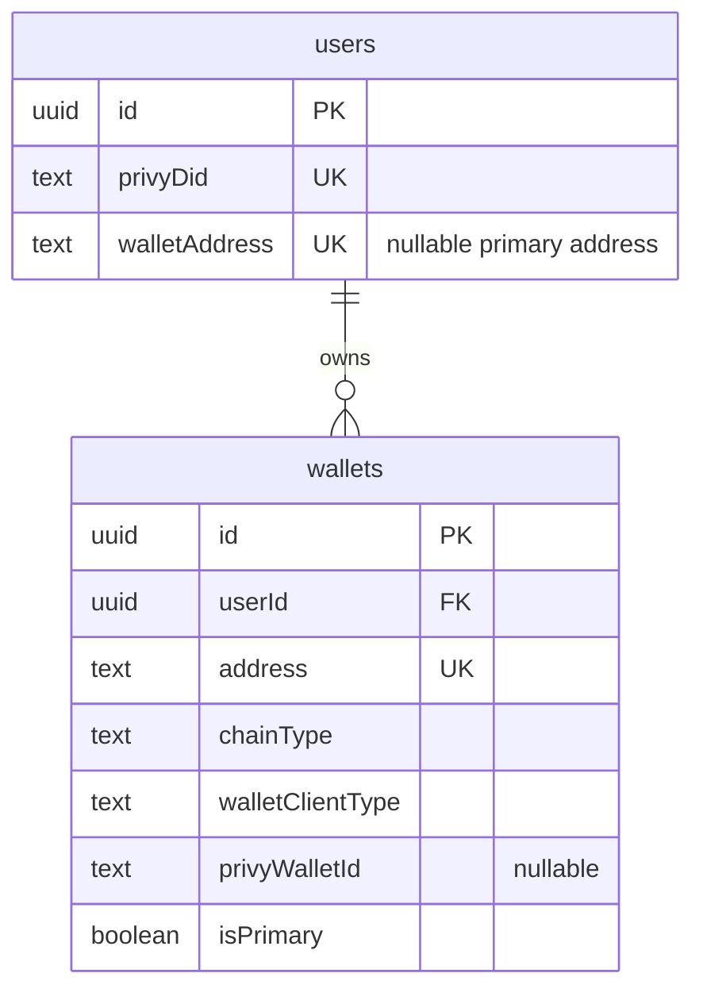
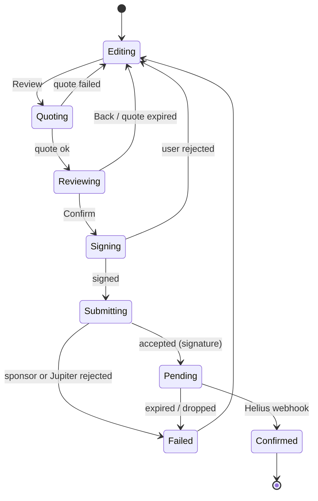
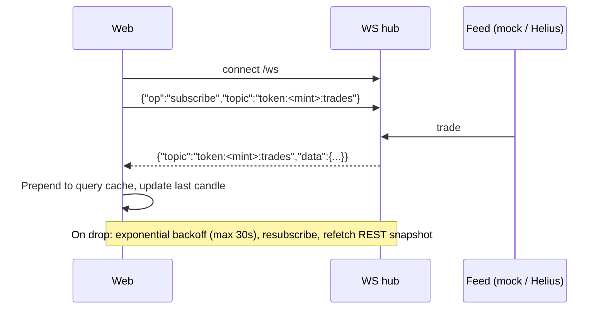

# Flows

## Sign-in and wallet

```mermaid
sequenceDiagram
  participant U as User
  participant W as Web (Privy SDK)
  participant P as Privy
  participant A as API
  U->>W: Sign in (email / Google)
  W->>P: Auth
  P-->>W: Access token + embedded Solana wallet
  W->>A: GET /v1/me (Bearer token)
  alt No PRIVY_APP_ID
    A-->>W: 503 auth_not_configured
  else Auth configured
    A->>A: verifyAccessToken (pinned key or JWKS)
    alt Invalid or expired token
      A-->>W: 401
    else Valid token
      A->>A: Upsert user by Privy DID
      opt walletAddress is null
        alt No PRIVY_APP_SECRET
          Note over A: Wallet linkage disabled; use stored wallets
        else Linkage enabled
          A->>P: Privy API users()._get(did)
          alt Privy lookup succeeds
            P-->>A: Linked accounts
            A->>A: Upsert Solana wallets; skip addresses owned by others
            A->>A: Set first stored embedded wallet as primary + walletAddress
          else Privy lookup fails
            Note over A: Warn; use stored wallets, walletAddress stays null
          end
        end
      end
      A-->>W: Profile + stored wallets
    end
  end
```



Signed-out users can browse every market; sign-in only gates trading, posting and following. Without `NEXT_PUBLIC_PRIVY_APP_ID` the web app runs in demo mode with sign-in disabled.

## Trade (quote, review, sign, receipt)

```mermaid
sequenceDiagram
  participant U as User
  participant W as Web
  participant A as API (SwapService)
  participant S as FeeSponsor
  participant J as Jupiter Swap V2
  U->>W: Enter amount, Review
  W->>A: POST /v1/swaps/quote
  A->>J: order (user wallet, our fee payer)
  J-->>A: Unsigned tx + quote (expiry)
  A-->>W: Quote: receive, min receive, fees, impact, expiry
  W->>U: Review dialog (explicit, no silent signing)
  U->>W: Confirm
  W->>W: Privy wallet signs
  W->>A: POST /v1/swaps/:id/submit (user-signed tx)
  A->>S: cosign (validate + simulate + quota)
  S-->>A: Fee-payer signature
  A->>J: execute
  J-->>A: Signature
  A-->>W: Receipt; Helius webhook later confirms fill
```

### Trade states



v0.1 stops at the review dialog: demo estimates come from fixture prices and submission is disabled. The quote/submit routes are specified by `SwapService` but not exposed yet.

## Realtime market data



Topics: `token:<mint>:trades`, `token:<mint>:price`, `leaderboard:global`; per-user alert topics are reserved. The status strip shows Live / Connecting / Reconnecting and the age of the last message; the chart never fills gaps with invented candles.

## PnL

Positions use average cost: buys raise quantity and blend cost; sells realize `(sell price - avg cost) × qty - fees` and leave avg cost unchanged. Transfers in with unknown basis are excluded from rankings. A daily BullMQ job writes `portfolio_snapshots` for the equity chart; leaderboards rank realized PnL per window from Redis sorted sets.
