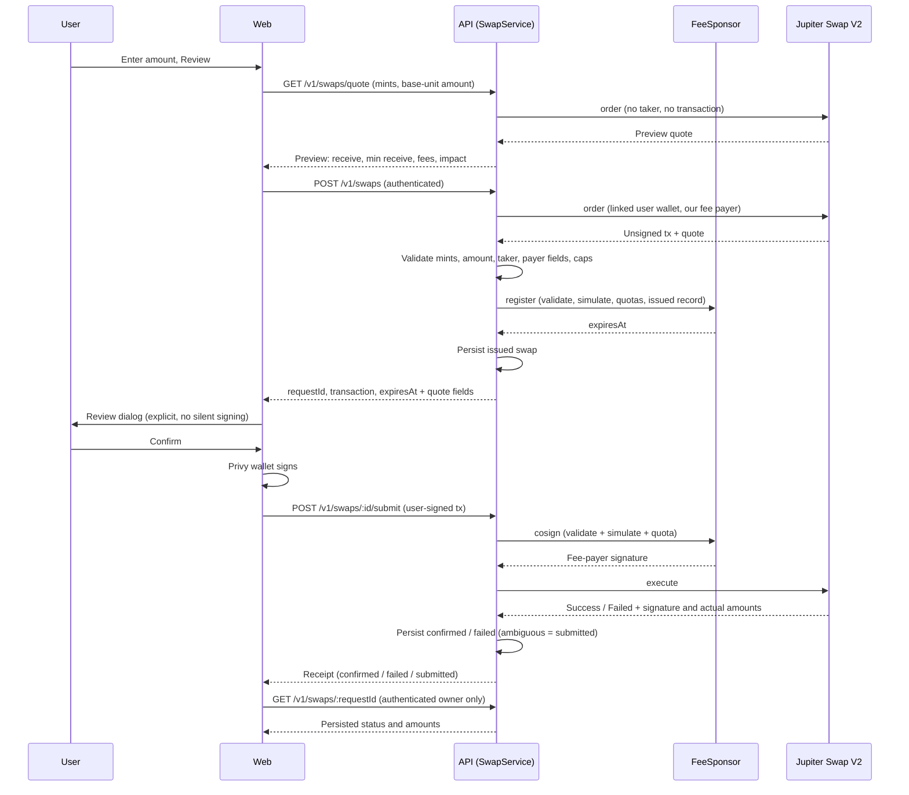
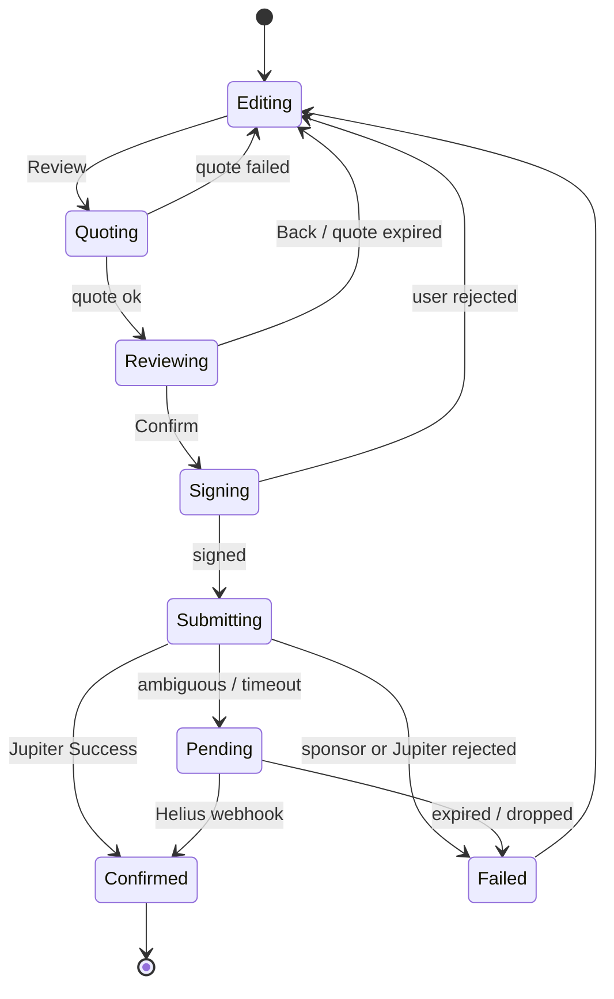
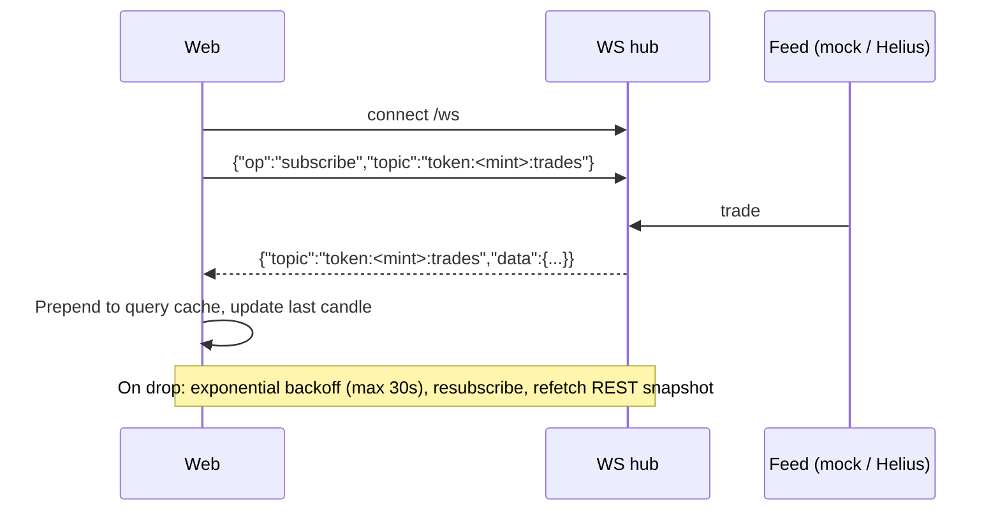

# Flows

## Sign-in and wallet

```mermaid
sequenceDiagram
  participant U as User
  participant W as Web (Privy SDK)
  participant P as Privy
  participant A as API
  U->>W: Sign in (email / Google)
  W->>P: Auth
  P-->>W: Access token + embedded Solana wallet
  W->>A: GET /v1/me (Bearer token)
  alt No PRIVY_APP_ID
    A-->>W: 503 auth_not_configured
  else Auth configured
    A->>A: verifyAccessToken (pinned key or JWKS)
    alt Invalid or expired token
      A-->>W: 401
    else Valid token
      A->>A: Upsert user by Privy DID
      opt walletAddress is null
        alt No PRIVY_APP_SECRET
          Note over A: Wallet linkage disabled; use stored wallets
        else Linkage enabled
          A->>P: Privy API users()._get(did)
          alt Privy lookup succeeds
            P-->>A: Linked accounts
            A->>A: Upsert Solana wallets; skip addresses owned by others
            A->>A: Set first stored embedded wallet as primary + walletAddress
          else Privy lookup fails
            Note over A: Warn; use stored wallets, walletAddress stays null
          end
        end
      end
      A-->>W: Profile + stored wallets
    end
  end
```

Signed-out users can browse every market; sign-in only gates trading, posting and following. Without `NEXT_PUBLIC_PRIVY_APP_ID` the web app runs in demo mode with sign-in disabled.

## Trade (quote, review, sign, receipt)



### Trade states



Routes:
- `GET /v1/swaps/quote?inputMint=...&outputMint=...&amount=...&slippageBps=50` is public and returns `{inAmount,outAmount,otherAmountThreshold,priceImpactPct,slippageBps,feeBps,router}`. Amounts are base-unit decimal strings; `priceImpactPct` is percentage points, not a decimal fraction.
- `POST /v1/swaps` requires Privy auth and a primary linked Solana wallet, with body `{inputMint,outputMint,amount,slippageBps?}`. Returns 201 `{requestId,transaction,expiresAt,...quoteFields}`. Expiry is Unix milliseconds, capped at 30 seconds and the sponsor's blockhash lifetime. The review dialog uses this build response, not an earlier preview; a new build requires a new signature.
- `POST /v1/swaps/{requestId}/submit` requires auth, body `{signedTransaction}`. Returns `{status:"confirmed"|"failed"|"submitted",signature?,inputAmountResult?,outputAmountResult?,code?,error?}`. Co-signed bytes go only to Jupiter, never the client or storage. A request is claimed atomically before co-signing; retries cannot sign or execute it again. Unknown execution outcomes stay `submitted`; reconciliation is indexing work, not an automatic resubmission.
- `GET /v1/swaps/{requestId}` requires auth and returns 404 unless owned by the caller. Response `{requestId,status,signature?,inAmount?,outAmount?,error?}`; status is `issued|submitted|confirmed|failed|expired`. `expired` is derived for unsubmitted issued swaps. Amounts are execution results when available, otherwise the original input and quoted output, not proof of a fill.

Build/submit return `503 trading_disabled` until a concrete enabled FeeSponsor is wired. Sponsor policy rejections return `422 sponsor_rejected`; order safety checks return `422 swap_rejected` with `details.reason`. The shared v0.1 mint list lives in `src/services/sponsor/swap-mints.ts`. Sponsor registration/co-signing owns the remaining policy checks (simulation, $5 minimums, rent/account limits, sponsored transaction/spend/failure quotas); no enabled fallback exists without them.

Jupiter V2 returns no single `payer` field: validate `rentFeePayer`, `prioritizationFeePayer` when present, and `signatureFeePayer` against our payer. JupiterZ may use a market maker for signatures (never the taker); the sponsor validates actual account roles. Current docs expose `priceImpact` in percentage points; legacy `priceImpactPct` is a decimal ratio and is multiplied by 100. Jupiter `Success` means landed, not merely submitted.

The `swaps` table is the source of truth for issued swaps and raw execution outcomes, with a unique signature. Existing `trades`/PnL rows are populated by indexing work; the swap API does not invent USD prices or token metadata.

The demo frontend may still show fixture estimates; live submission remains disabled until the concrete sponsor passes the security-policy checks.

## Realtime market data



Topics: `token:<mint>:trades`, `token:<mint>:price`, `leaderboard:global`; per-user alert topics are reserved. The status strip shows Live / Connecting / Reconnecting and the age of the last message; the chart never fills gaps with invented candles.

## PnL

Positions use average cost: buys raise quantity and blend cost; sells realize `(sell price - avg cost) × qty - fees` and leave avg cost unchanged. Transfers in with unknown basis are excluded from rankings. A daily BullMQ job writes `portfolio_snapshots` for the equity chart; leaderboards rank realized PnL per window from Redis sorted sets.
