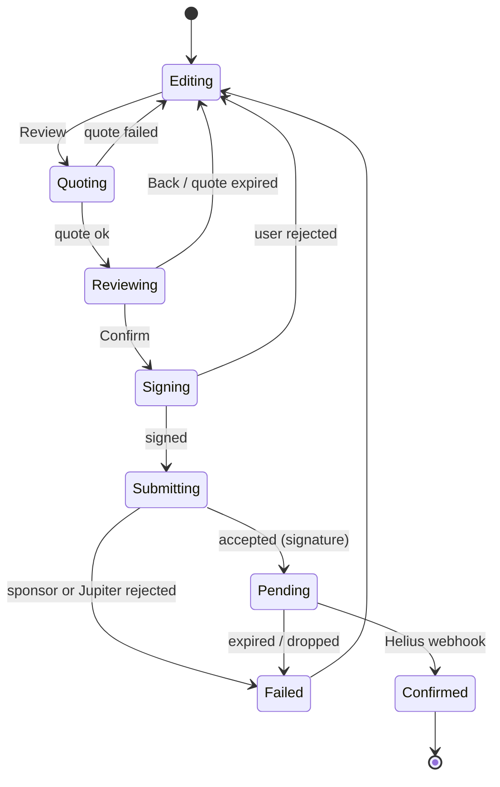
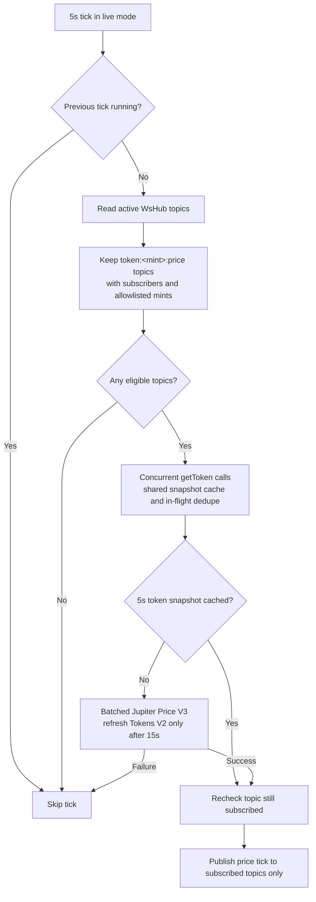
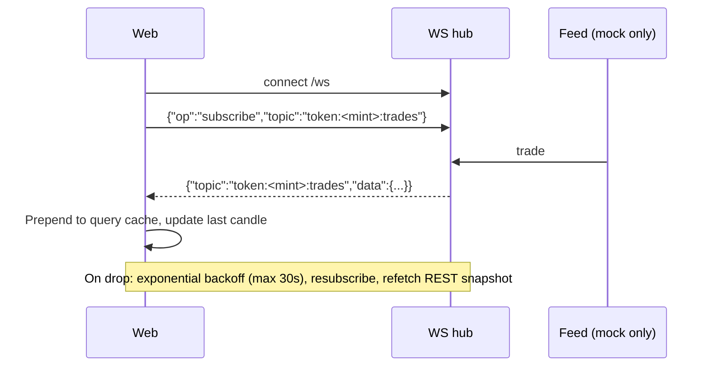
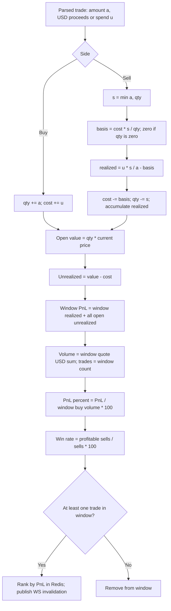

# Flows

## Sign-in and wallet

```mermaid
sequenceDiagram
  participant U as User
  participant W as Web (Privy SDK)
  participant P as Privy
  participant A as API
  U->>W: Sign in (email / Google)
  W->>P: Auth
  P-->>W: Access token + embedded Solana wallet
  W->>A: GET /v1/me (Bearer token)
  alt No PRIVY_APP_ID
    A-->>W: 503 auth_not_configured
  else Auth configured
    A->>A: verifyAccessToken (pinned key or JWKS)
    alt Invalid or expired token
      A-->>W: 401
    else Valid token
      A->>A: Upsert user by Privy DID
      opt walletAddress is null
        alt No PRIVY_APP_SECRET
          Note over A: Wallet linkage disabled; use stored wallets
        else Linkage enabled
          A->>P: Privy API users()._get(did)
          alt Privy lookup succeeds
            P-->>A: Linked accounts
            A->>A: Upsert Solana wallets; skip addresses owned by others
            A->>A: Set first stored embedded wallet as primary + walletAddress
          else Privy lookup fails
            Note over A: Warn; use stored wallets, walletAddress stays null
          end
        end
      end
      A-->>W: Profile + stored wallets
    end
  end
```

Signed-out users can browse every market; sign-in only gates trading, posting and following. Without `NEXT_PUBLIC_PRIVY_APP_ID` the web app runs in demo mode with sign-in disabled.

## Trade (quote, review, sign, receipt)

```mermaid
sequenceDiagram
  participant U as User
  participant W as Web
  participant A as API (SwapService)
  participant S as FeeSponsor
  participant J as Jupiter Swap V2
  U->>W: Enter amount, Review
  W->>A: POST /v1/swaps/quote
  A->>J: order (user wallet, our fee payer)
  J-->>A: Unsigned tx + quote (expiry)
  A-->>W: Quote: receive, min receive, fees, impact, expiry
  W->>U: Review dialog (explicit, no silent signing)
  U->>W: Confirm
  W->>W: Privy wallet signs
  W->>A: POST /v1/swaps/:id/submit (user-signed tx)
  A->>S: cosign (validate + simulate + quota)
  S-->>A: Fee-payer signature
  A->>J: execute
  J-->>A: Signature
  A-->>W: Receipt; Helius webhook later confirms fill
```

### Trade states



v0.1 stops at the review dialog: demo estimates come from fixture prices and submission is disabled. The quote/submit routes are specified by `SwapService` but not exposed yet.

## Market data

Live is the default; `MARKET_DATA_PROVIDER=mock` keeps offline/demo feeds.
Caches deduplicate in-flight requests; failures/timeouts return 502, not fixtures.

```mermaid
sequenceDiagram
  participant C as Client
  participant A as API / live provider
  participant K as In-memory cache
  participant J as Jupiter
  participant B as Birdeye
  C->>A: GET /v1/tokens/{mint} or /trending
  alt Detail mint not allowlisted
    A-->>C: 404
  else Allowlisted detail or curated trending
    A->>K: Read token snapshot (5s TTL)
    alt Cache miss
      K->>J: Tokens V2 search (15s cache, batches <=100)
      J-->>K: Metadata + 24h stats
      K->>J: Price V3 (batches <=50)
      J-->>K: USD prices
    end
    K-->>A: Mapped tokens
    A-->>C: Token or volume-ranked trending list (limit)
  end
  C->>A: GET /v1/tokens/{mint}/candles or /trades
  Note over A,K: Resolve token first via the same allowlist/cache path; unknown = 404
  alt BIRDEYE_API_KEY unset
    A-->>C: 503 service_unavailable
  else Key configured
    A->>K: Read candles (30s) or trades (5s)
    alt Cache miss
      K->>B: OHLCV V3 or token swap txs (Solana, API key)
      B-->>K: Candles with USD volume or swap legs
    end
    K-->>A: Oldest-first candles / newest-first trades
    A-->>C: Mapped DTOs
  end
```

### Price WebSocket ticks

Payload: `{mint,priceUsd,marketCapUsd,time}`; time is Unix seconds.



The shared provider batches the allowlist, not one request per subscriber.
Mock mode emits synthetic price ticks on its mock-feed timer only.

### Trade WebSocket topics (mock only)



Topics: `token:<mint>:trades`, `token:<mint>:price`, `leaderboard:global`; per-user alert topics are reserved. The status strip shows Live / Connecting / Reconnecting and the age of the last message; the chart never fills gaps with invented candles.

## PnL



Zero denominators produce zero. Native SOL network fees are added back before
classification, not subtracted again from realized PnL. SOL-quoted USD values use
current SOL pricing; historical prices remain a TODO. Unknown current token prices
use average cost (zero unrealized). Transfers/unknown basis are not indexed.
Stablecoin quote legs take priority over SOL; dust below 0.000000001 units is ignored.

### Portfolio reads and daily snapshots

```mermaid
sequenceDiagram
  participant C as Authenticated client
  participant A as PortfolioService
  participant D as PostgreSQL
  participant M as MarketDataProvider
  participant S as Solana JSON-RPC
  C->>A: GET /v1/me/portfolio
  A->>D: ensureUser; positions + linked wallets
  A->>M: Current held-token prices
  A->>S: getTokenAccountsByOwner (USDC, jsonParsed)
  A-->>C: equity = USDC + open value; open positions + total PnL
  C->>A: GET /v1/me/portfolio/history?range=7d|30d|all
  A->>D: Daily snapshots ascending within range
  A-->>C: UTC midnight points + final live equity point
  C->>A: GET /v1/me/trades?limit=25&cursor=opaque
  A->>D: Keyset by executedAt DESC, id DESC
  A-->>C: UserTrade entries + nextCursor or null
  Note over A,D: Daily worker reuses valuation and upserts (userId, UTC day)
```

Closed positions contribute accumulated realized PnL but are not listed. Buys
return `realizedPnlUsd: null` in `UserTrade`. Malformed cursors return 400; missing
auth returns 401. USDC RPC failures log and return zero. Range start is UTC midnight
7/30 days before today (inclusive), or all stored days. No synthetic history is added.
