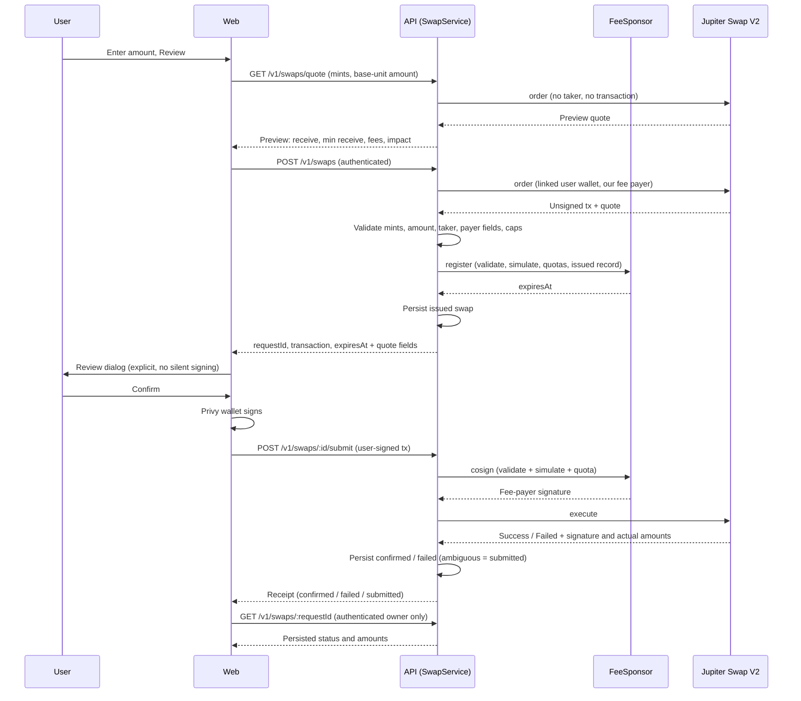
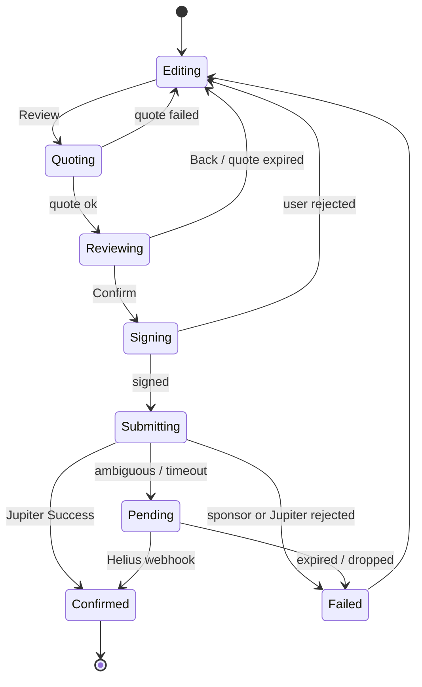
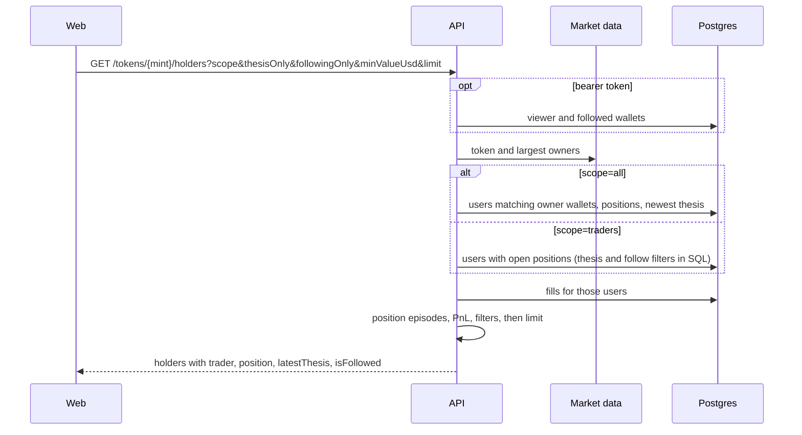
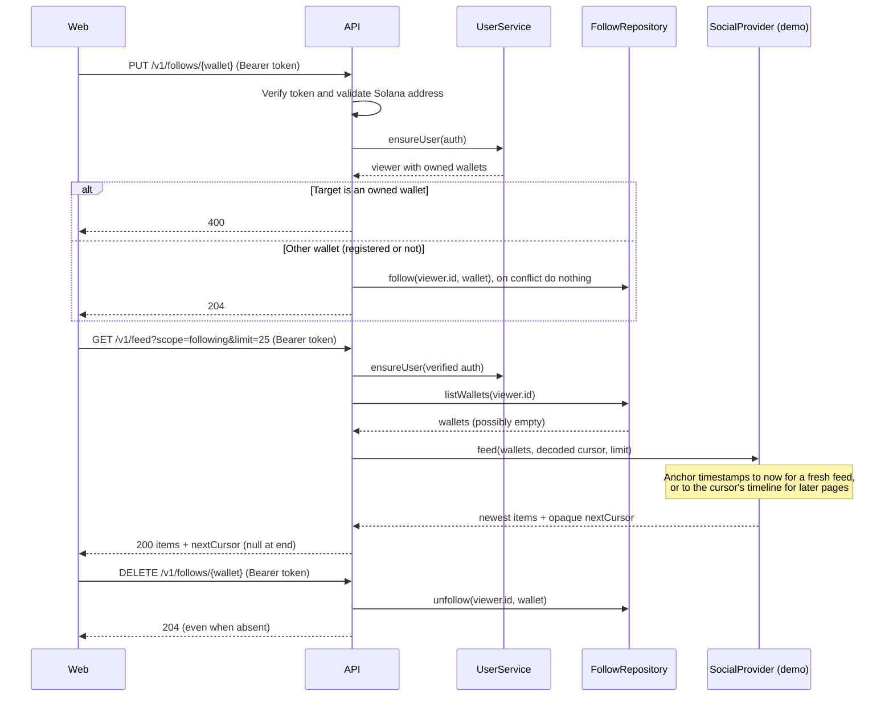
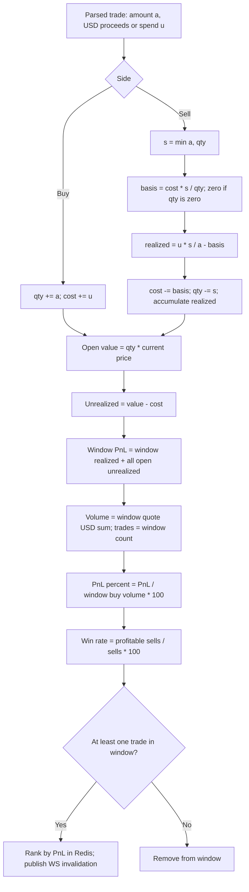
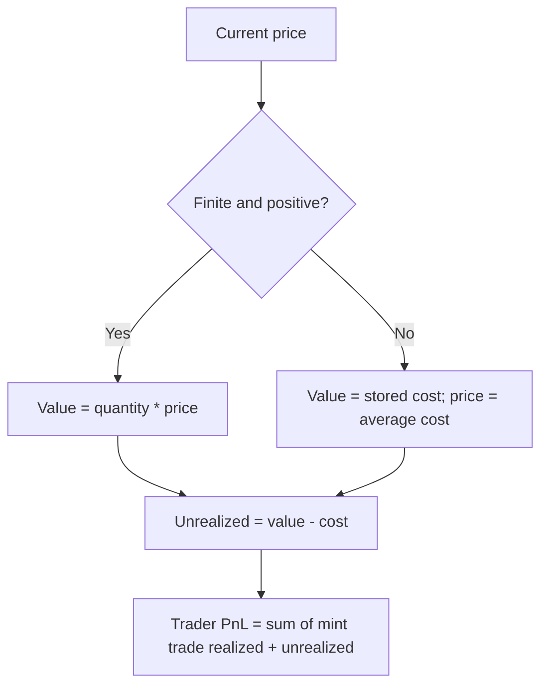

# Flows

## Sign-in and wallet

```mermaid
sequenceDiagram
  participant U as User
  participant W as Web (Privy SDK)
  participant P as Privy
  participant A as API
  U->>W: Sign in (email / Google)
  W->>P: Auth
  P-->>W: Access token + embedded Solana wallet
  W->>A: GET /v1/me (Bearer token)
  alt No PRIVY_APP_ID
    A-->>W: 503 auth_not_configured
  else Auth configured
    A->>A: verifyAccessToken (pinned key or JWKS)
    alt Invalid or expired token
      A-->>W: 401
    else Valid token
      A->>A: Upsert user by Privy DID
      opt walletAddress is null
        alt No PRIVY_APP_SECRET
          Note over A: Wallet linkage disabled; use stored wallets
        else Linkage enabled
          A->>P: Privy API users()._get(did)
          alt Privy lookup succeeds
            P-->>A: Linked accounts
            A->>A: Upsert Solana wallets; skip addresses owned by others
            A->>A: Set first stored embedded wallet as primary + walletAddress
          else Privy lookup fails
            Note over A: Warn; use stored wallets, walletAddress stays null
          end
        end
      end
      A-->>W: Profile + stored wallets
    end
  end
```

Signed-out users can browse every market; sign-in only gates trading, posting and following. Without `NEXT_PUBLIC_PRIVY_APP_ID` the web app runs in demo mode with sign-in disabled.

## Trade (quote, review, sign, receipt)



### Trade states



Routes:
- `GET /v1/swaps/quote?inputMint=...&outputMint=...&amount=...&slippageBps=50` is public and returns `{inAmount,outAmount,otherAmountThreshold,priceImpactPct,slippageBps,feeBps,router}`. Amounts are base-unit decimal strings; `priceImpactPct` is percentage points, not a decimal fraction.
- `POST /v1/swaps` requires Privy auth and a primary linked Solana wallet, with body `{inputMint,outputMint,amount,slippageBps?}`. Returns 201 `{requestId,transaction,expiresAt,...quoteFields}`. Expiry is Unix milliseconds, capped at 30 seconds and the sponsor's blockhash lifetime. The review dialog uses this build response, not an earlier preview; a new build requires a new signature.
- `POST /v1/swaps/{requestId}/submit` requires auth, body `{signedTransaction}`. Returns `{status:"confirmed"|"failed"|"submitted",signature?,inputAmountResult?,outputAmountResult?,code?,error?}`. Co-signed bytes go only to Jupiter, never the client or storage. A request is claimed atomically before co-signing; retries cannot sign or execute it again. Unknown execution outcomes stay `submitted`; reconciliation is indexing work, not an automatic resubmission.
- `GET /v1/swaps/{requestId}` requires auth and returns 404 unless owned by the caller. Response `{requestId,status,signature?,inAmount?,outAmount?,error?}`; status is `issued|submitted|confirmed|failed|expired`. `expired` is derived for unsubmitted issued swaps. Amounts are execution results when available, otherwise the original input and quoted output, not proof of a fill.
- `GET /v1/swaps?limit=25&cursor=...` requires auth and lists only the caller's swaps, including expired issued records, without requiring a linked wallet or enabled trading. Returns `{items,nextCursor}`; items contain the status response fields plus `inputMint`, `outputMint`, and `createdAt` (UTC ISO 8601). Amounts have the same execution-or-quote semantics as status. Newest first by creation time at millisecond precision, then request ID descending for stable ties. Limit defaults to 25, maximum 100. Like the feed, cursors are opaque base64url JSON: pass `nextCursor` unchanged; `null` means no further page. Malformed cursors/limits return 400. This supplies the terminal's My Swaps placeholder; frontend consumption is a separate change.

Build/submit return `503 trading_disabled` until a concrete enabled FeeSponsor is wired. Sponsor policy rejections return `422 sponsor_rejected`; order safety checks return `422 swap_rejected` with `details.reason`. The shared v0.1 mint list lives in `src/services/sponsor/swap-mints.ts`. Sponsor registration/co-signing owns the remaining policy checks (simulation, $5 minimums, rent/account limits, sponsored transaction/spend/failure quotas); no enabled fallback exists without them.

Jupiter V2 returns no single `payer` field: validate `rentFeePayer`, `prioritizationFeePayer` when present, and `signatureFeePayer` against our payer. JupiterZ may use a market maker for signatures (never the taker); the sponsor validates actual account roles. Current docs expose `priceImpact` in percentage points; legacy `priceImpactPct` is a decimal ratio and is multiplied by 100. Jupiter `Success` means landed, not merely submitted.

The `swaps` table is the source of truth for issued swaps and raw execution outcomes, with a unique signature. Existing `trades`/PnL rows are populated by indexing work; the swap API does not invent USD prices or token metadata.

The demo frontend may still show fixture estimates; live submission remains disabled until the concrete sponsor passes the security-policy checks.

## Market data

See [chain ingest and simulator](ingest.md) for Pulse, candles, holdings and
WebSocket flows. Indexed mints resolve from Postgres; unindexed mints resolve
through Jupiter Tokens V2 and Price V3, with Birdeye for candles and trades.
Unknown mints return 404 and upstream failures return 502; uncached Birdeye
requests without a key return 503.

For unindexed holders, Solana RPC returns the largest 20 token accounts and
total supply. The provider merges accounts by owner, labels known pool
authorities (currently Raydium AMM v4), and ranks the owners. Indexed holders
instead reflect positive net positions from ingested trades.

## Token holders with theses

`GET /v1/tokens/{mint}/holders` serves the token page Holders tab.

- `scope=all` (default): the largest owner wallets from market data, as above.
  A wallet that belongs to an Agele trader (primary or linked) gets `trader`,
  `position` and `latestThesis`; other rows have them as `null`.
- `scope=traders`: Agele traders with an open indexed position in the mint,
  largest amount first (first 200). Value and PnL use the same position quote
  as portfolio, falling back to average cost; `X-Data-Source: indexed`.
- `thesisOnly`, `followingOnly` and `minValueUsd` filter before `limit`
  (1-50). `followingOnly` needs a bearer token and returns 401 without one;
  `isFollowed` is `false` for anonymous viewers.
- `position` is the open position episode: opening fill ID for replay,
  first buy time, invested USD, buy-weighted entry market cap, realized,
  unrealized and total PnL. `trader.avgHoldSeconds` averages closed positions.
- `latestThesis` is the trader's newest thesis version on the mint, with like,
  reply and view counts.

Demo mode only swaps the source: seeded traders hold seeded mints, most with a
thesis, and four also hold a second mint without one, so Thesis only and
Following only have rows to keep and drop.



## Follow and following feed



Global feed is public and is the default scope; following scope without a bearer token returns 401. Optional authentication on feed and leaderboard means no header is anonymous, but a present invalid header returns 401. Invalid cursors, limits, scopes and wallet addresses return 400. Following nobody returns an empty page. Feed content remains demo data, independent of indexed leaderboard rankings. Trades include side/amountUsd, theses include body, and both use the comment position enum and Unix-second timestamps. Authenticated leaderboard entries include `isFollowing` for both indexed and demo rankings; anonymous entries omit it.

## PnL



Zero denominators produce zero. Native SOL network fees are added back before
classification, not subtracted again from realized PnL. SOL-quoted USD values use
current SOL pricing; historical prices remain a TODO. Unknown current token prices
or zero prices use average cost (zero unrealized). Transfers are not indexed.
Tokens acquired before indexing or delivered out of order have unknown (zero) basis;
sells without indexed holdings record zero realized PnL. Transactions are not reordered.
Stablecoin quote legs take priority over SOL; dust below 0.000000001 units is ignored.

### Portfolio reads and daily snapshots

```mermaid
sequenceDiagram
  participant C as Authenticated client
  participant A as PortfolioService
  participant D as PostgreSQL
  participant M as MarketDataProvider
  participant S as Solana JSON-RPC
  C->>A: GET /v1/me/portfolio
  A->>D: ensureUser; positions + linked wallets
  A->>M: Current held-token prices
  A->>S: getTokenAccountsByOwner (USDC + USDT, jsonParsed); getBalance (native SOL)
  A-->>C: equity = USDC + USDT + SOL * current price + open value
  C->>A: GET /v1/me/portfolio/history?range=7d|30d|all
  A->>D: Daily snapshots ascending within range
  A-->>C: UTC midnight points + final live equity point
  C->>A: GET /v1/me/trades?limit=25&cursor=opaque
  A->>D: Keyset by executedAt DESC, id DESC
  A-->>C: UserTrade entries + nextCursor or null
  Note over A,D: Daily worker includes cash-only linked wallets and upserts (userId, UTC day)
```

Closed positions contribute accumulated realized PnL but are not listed. Buys
return `realizedPnlUsd: null` in `UserTrade`. Malformed cursors return 400; missing
auth returns 401. RPC failures log and omit only the failed wallet/asset, retaining
successful balances. `usdcBalance` is USDC only. Missing/zero SOL prices value
native SOL cash at zero. Range start is UTC midnight
7/30 days before today (inclusive), or all stored days. No synthetic history is added.

## Token terminal positions and traders

```mermaid
sequenceDiagram
  participant C as Token page
  participant A as TokenActivityService
  participant D as PostgreSQL
  participant M as MarketDataProvider
  C->>A: GET /v1/tokens/{mint}/positions (Bearer token)
  A->>D: ensureUser; token metadata; viewer's position by mint
  A->>M: Current token price
  A-->>C: position or null; X-Data-Source: indexed
  C->>A: GET /v1/tokens/{mint}/traders?limit=25&cursor=opaque (public)
  A->>D: Aggregate mint trades by user; join users + mint positions
  Note over A,D: Volume DESC, userId ASC; exclusive cursor; fetch limit + 1
  A->>M: Current token price
  A-->>C: traders + nextCursor; X-Data-Source: indexed
```

The authenticated **positions** response is `{position: TokenPosition | null}`.
`TokenPosition` reuses the portfolio fields `mint`, `symbol`, `quantity`,
`avgCostUsd`, `priceUsd`, `valueUsd`, `unrealizedPnlUsd`, `realizedPnlUsd`.
It includes closed positions (`quantity: 0`, `avgCostUsd: 0`) so their realized
PnL remains visible; no position row returns null. Requests never return another
user's position. There are no position query parameters because there is at most
one row per user/mint.

The public **traders** response is `{traders: TokenTrader[], nextCursor: string | null}`.
Each entry has `wallet` (primary wallet, nullable when absent), `handle` (fallback:
first eight characters of wallet or user ID), `buys`, `sells` (trade counts),
`volumeUsd`, `realizedPnlUsd`, `unrealizedPnlUsd`, and `pnlUsd` (the last two summed).
Metrics cover **all indexed history for this mint**, not a time window and not all
on-chain traders. Only users with at least one trade in the mint are listed.
Ranking is by lifetime USD volume, not PnL. `limit` is 1–100 (default 25).
The opaque base64url cursor holds the mint, exact decimal volume, and user ID;
it is exclusive, tied to its mint, and returns 400 when malformed. Numeric ordering
and the user ID tie-breaker prevent duplicates on unchanged data. Pagination is
live, not snapshot-isolated: newly indexed trades can move a user across pages.



Known mints without data return null/empty with 200; a mint absent from both
PostgreSQL metadata and the market provider returns 404. Invalid mint length or
query input returns 400; missing/invalid position authentication returns 401.
Missing/zero prices fall back to each user's own cost (zero unrealized PnL).
Provider/DB errors propagate rather than returning synthetic data. Both responses
are labelled `indexed`, even with mock market prices or disabled webhook ingestion.
The frontend must wire these new endpoints; its existing tabs have no API contract.
No holders or my-swaps endpoint is added.

## Trader profiles

```mermaid
sequenceDiagram
  participant C as Trader page
  participant A as TraderService
  participant D as PostgreSQL
  participant P as PortfolioService
  participant L as LeaderboardService
  participant R as Redis
  C->>A: GET /v1/traders/{wallet} (optional Bearer)
  A->>D: Resolve linked wallet, fallback legacy primary wallet
  alt Stored trader
    A->>D: Linked addresses; distinct follower users; following wallet count
    A->>P: Position summary (no cash balance RPC)
    A->>L: Reuse window stats with current market prices
    L->>R: ZREVRANK per active window
    A-->>C: Profile + open positions + stats; X-Data-Source: indexed
  else Known demo leaderboard/feed wallet
    A->>A: Same MockSocialProvider rankings for all windows
    A-->>C: Simulated profile; X-Data-Source: demo
  else Unknown wallet
    A-->>C: 404
  end
  C->>A: GET /v1/traders/{wallet}/trades?limit=25&cursor=opaque
  A->>P: Reuse UserTrade keyset page for stored trader
  A-->>C: trades + nextCursor; demo history is empty
```

Profile shape: `{wallet, handle, avatarUrl: string | null, followers, following,
isFollowing?, realizedPnlUsd, unrealizedPnlUsd, stats, positions}`. `positions` is
the portfolio's open-position array; closed positions still count toward lifetime
realized PnL. No cash balances or private auth/wallet metadata are exposed.
`stats` has keys `24h`, `7d`, `30d`, each with `{pnlUsd, pnlPct, volumeUsd, trades,
winRatePct, rank: number | null}` using existing leaderboard units and math.
Inactive windows still show open unrealized PnL, but have zero trading metrics
and null rank. Redis ranks may lag fresh prices/trades; reads do not mutate ranks
or publish WS events. Price missing/zero means cost fallback, as in portfolios.

Linked secondary wallets resolve to the same user and canonical primary wallet.
Followers count distinct registered users following **any** linked address
(including legacy primary); following counts wallet-follow rows for this user.
Authenticated `isFollowing` checks any linked address. Anonymous responses omit
the property entirely. Present invalid bearer tokens return 401 on both routes;
authentication configuration errors return 503. Malformed input/cursors return
400, unknown wallets return 404. Only wallet lookup is supported because both
leaderboard and feed expose wallet addresses directly for links.

Stored traders resolve even if indexing is not currently configured; their data
is labelled `indexed` and ranks are null if the indexed leaderboard is disabled.
Demo wallets resolve even when indexing is enabled because the feed remains demo.
Demo window stats match the mock leaderboard exactly; demo lifetime realized PnL
uses its simulated 30d PnL, unrealized PnL is zero, holdings/history are empty and
following is zero. Follower counts and viewer follow state still use real follows.
Demo data is never substituted on database, market-provider or Redis failures.

Trade pages use exactly the `/v1/me/trades` `UserTrade` schema and `(executedAt,id)`
descending keyset cursor, with limit 1–100 (default 25). History is user-wide across
linked wallets. Recent trades are fetched via this separate paginated endpoint,
not embedded unboundedly in the profile. No frontend code is changed.
