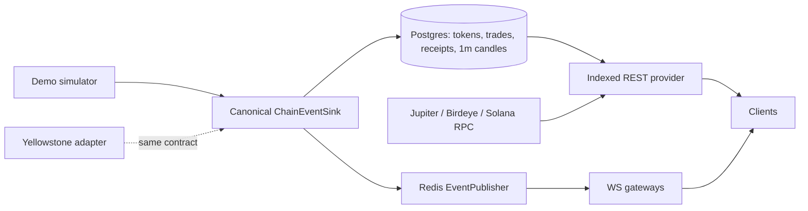
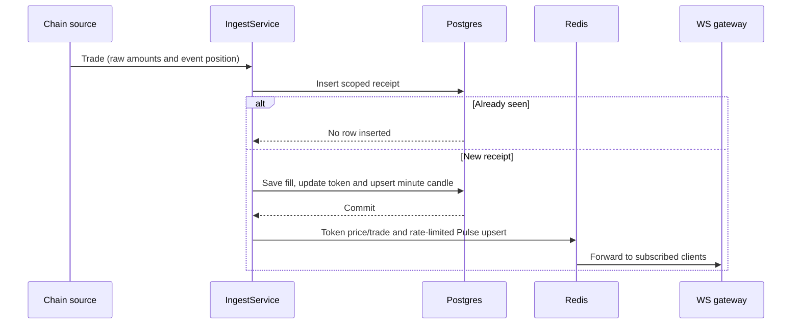
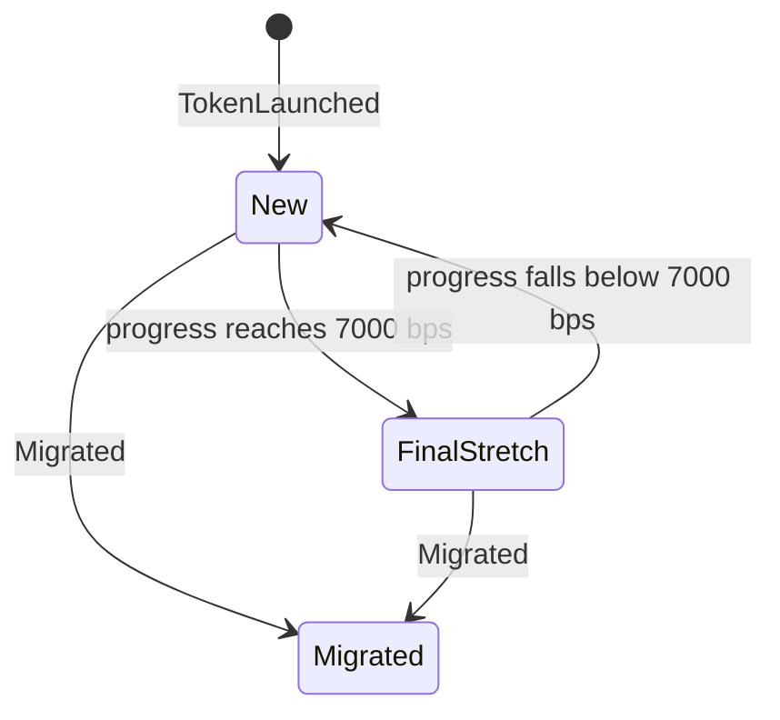

# Chain ingest and demo simulator

`src/services/chain-ingest/events.ts` is shared by chain sources and the sink.
`ChainEventSource.run(sink, signal)` emits `TokenLaunched`, SOL-quoted `Trade` and
`Migrated` events in ascending (slot, transaction index, event index) order.
The sink validates events, then commits each batch as a transaction. Receipts
are keyed by (source, signature, event index) to prevent replays from
double-counting trades, volume or candles. Supply and missing block times are
resolved from Solana RPC for the live source; the simulator supplies both locally.

`createChainIngest` selects the source, SOL/USD quote and chain facts together.
`CHAIN_SOURCE=demo` uses the simulator, local facts and a repeatable mean-reverting
walk around $180. When available, register the Yellowstone adapter with
`JupiterSolUsdPrice` (current wSOL quote from Jupiter Price V3) and `RpcChainFacts`.
The adapter must deliver launch events before trades for a mint.
Launch metadata resolves from HTTPS, IPFS via a gateway, or data JSON,
and is cached on the token row. Remote metadata requests have a 3-second timeout,
128 KiB limit, public IPv4-only DNS, and no redirects. Missing/invalid metadata
falls back to the mint as the name and a null image.

## Trade, candles and realtime

Prices are SOL lamports / 1e9, divided by token UI amount, multiplied by SOL/USD.
Volumes are USD. One-minute candles update on every newly accepted trade;
older fills can adjust the open, close, high or low, using event order for ties
at the same Unix second. Higher intervals aggregate minute buckets in SQL.
Holders are positive indexed net trade positions, not wallet balances. Indexed
liquidity is an estimate from cumulative net USD inflows on both sides of the
pool, not on-chain TVL; deposits/withdrawals are not in the event contract.

The feed checks the Redis lease before each batch and aborts/awaits its source
on loss or shutdown. The simulator replays three hours in batches and starts
launching tokens every 5–12 seconds afterward. History is deterministic within
each five-minute start epoch, so a replay within that epoch dedupes. Live
transactions get fresh signatures even when the feed restarts in the same epoch. Historical
fills are available via REST but are not broadcast to WS clients. Tokens use
synthetic base58 addresses and signatures with source `demo`, remote DiceBear
images and a reusable trader wallet pool. A pump.fun-style curve starts with
30 virtual SOL and 1.073B virtual tokens; it graduates at 85 net real SOL,
then continues on a simulated PumpSwap pool.

## Pulse

`GET /v1/pulse?limit=30` returns `source` (`demo` or `indexed`) and the arrays
`new`, `finalStretch` and `migrated`. Limits (1–100) apply per lane. New sorts
by launch time descending, Final stretch by curve progress descending and
Migrated by migration time descending. Timestamps are Unix seconds.

On `pulse`, WS pushes `{type:"upsert", stage, token}` at most once per second per
mint, or `{type:"migrated", mint, migratedVenue, migratedAt}` on a migration.
WS is ephemeral: reconnect by fetching the full Pulse board and any open
trade/candle views. Postgres remains authoritative if realtime delivery fails.
