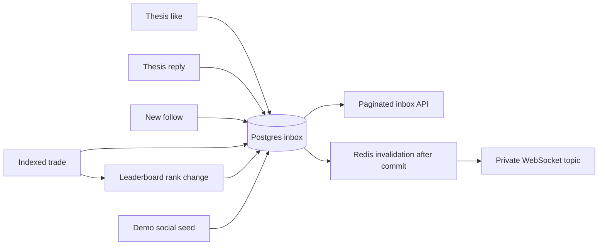
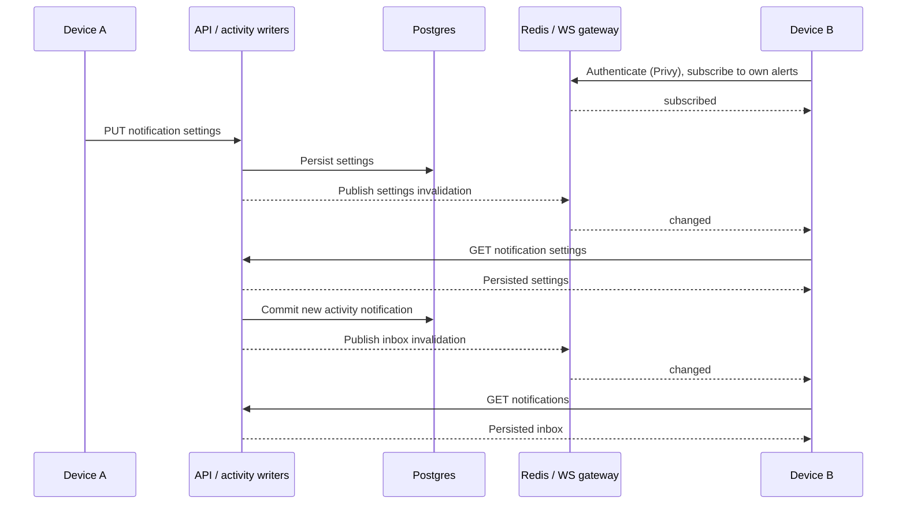

# Notifications and trader activity alerts

## API

| Method | Route | Behavior |
| --- | --- | --- |
| GET | `/v1/me/notifications?limit=25&cursor=…` | Newest first; returns `items`, `nextCursor`, and `source`. Omit the cursor or pass an empty one for the newest page. |
| GET | `/v1/me/notifications/unread-count` | Returns `{unreadCount}`, counting each group as one item. |
| PUT | `/v1/me/notifications/{id}/read` | Marks the item (or its whole group) read and returns `{unreadCount}`. Retrying is safe. |
| PUT | `/v1/me/notifications/read-all` | Marks the signed-in account's inbox read and returns `{unreadCount}`. |
| GET | `/v1/me/notifications/settings` | Get the signed-in account's `{traderActivity, sound}` settings. Defaults are `true` and `false`, respectively. |
| PUT | `/v1/me/notifications/settings` | Replace both boolean settings and notify the account's connected devices. |

Every route requires a valid Privy bearer token. The API matches the signed-in DID to its account; it never accepts a client-supplied recipient. With the demo chain source and indexed market provider, a signed-in account receives its own copy of the Postgres seed (`source: "demo"`) so read state stays private. Demo mode needs sign-in for this feature; it removes the need for live market and chain keys, not the need for authentication.

Each item includes `id`, `kind`, `createdAt`, nullable `readAt`, `actors` (up to three), `actorCount`, and a kind-specific `target`. A group stays unread as long as any event in it is unread.

- `thesis_like`: grouped by liked version and UTC day. Open `/v1/tokens/{target.mint}/theses/{target.thesisId}`; `target.commentId` identifies the liked version. Self-likes and retries do not notify.
- `thesis_comment`: a reply in a thesis thread. `target.commentId` identifies the exact reply.
- `follow`: grouped by UTC day, with the total actor count and up to three newest actors. Re-following the same account that day does not add another event.
- `trader_trade`: a buy or sell in a followed wallet or the primary wallet's linked account, if trader activity is enabled. `target.positionId` is the opening fill ID for that position, or null when no position can be resolved.
- `leaderboard`: the account's rank changed in a window, including displacement by another account and changes first detected during a scheduled rebuild.

## Realtime

1. Call `GET /v1/me` to establish the account. Use `walletAddress` or, if absent, the linked Solana address (primary first, then address order).
2. On `/ws`, send `{"op":"authenticate","token":"<Privy access token>"}`. Wait for `{"type":"authenticated"}`, then subscribe with `{"op":"subscribe","topic":"user:<wallet>:notifications"}`. The gateway only authorizes the account's own topic.
3. The event's `data` is exactly `{"type":"changed"}`. Refresh inbox, unread count, and settings as needed. Clients play sound for new `trader_trade` items if the account's persisted `sound` setting is enabled; the event itself does not carry a sound flag. Refetch on reconnect, since Redis invalidations are not durable. Reconnect with a fresh token after the server closes the authenticated socket at expiration.

Run the Drizzle migrations before deploying. Production uses the existing Postgres, Redis and Privy setup; the WS process also needs `PRIVY_APP_ID` and database access, with `PRIVY_VERIFICATION_KEY` optional when using JWKS. Trader activity and leaderboard events require the existing Helius indexing configuration and worker.
