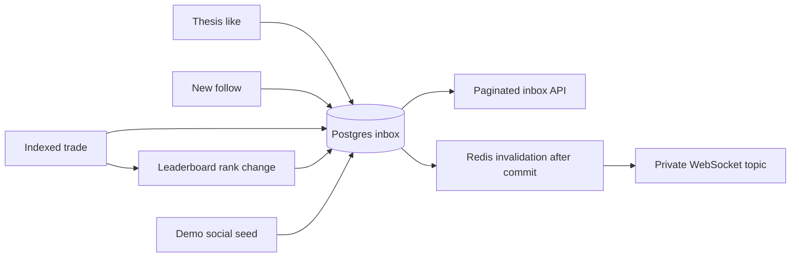
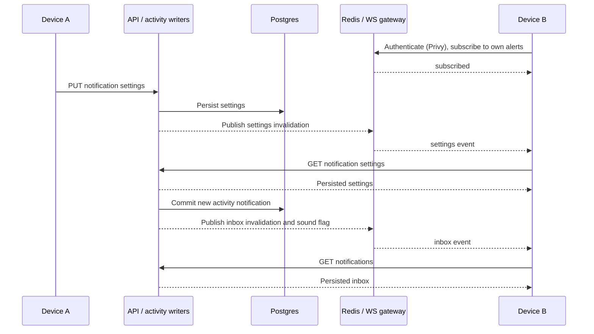

# Notifications and trader activity alerts

## API

| Method | Route | Behavior |
| --- | --- | --- |
| GET | `/v1/notifications?limit=30&cursor=…` | Newest first; returns `items`, `nextCursor`, and `source`. Omit the cursor for the newest page. |
| GET | `/v1/notifications/settings` | Get the signed-in account's `{traderActivity, sound}` settings. Defaults are `true` and `false`, respectively. |
| PUT | `/v1/notifications/settings` | Replace both boolean settings and notify the account's connected devices. |

The inbox uses the signed-in account mapped from its Privy DID, never a recipient supplied by a client. A keyless startup (`CHAIN_SOURCE=demo` and `MARKET_DATA_PROVIDER=indexed`) serves the seeded Postgres inbox to unauthenticated callers with `source: "demo"`. Signed-in requests still use their own inbox; sending an invalid bearer never falls back to demo. Demo requests cannot read live inbox records, change alert settings, or subscribe to the demo persona. In live mode every request needs a Privy bearer token.

- `thesis_like`: open `/v1/tokens/{token.mint}/theses/{details.thesisId}`. `postId` identifies the liked version. Self-likes and retries do not notify.
- `follow`: grouped by UTC day, with the total count and up to three newest actors. Re-following the same account during that day does not add another event.
- `trader_activity`: an indexed buy or sell in a followed wallet or the primary wallet's linked account, if trader activity is enabled. Includes trade ID, signature and side.
- `leaderboard`: an indexed trade changed the account's own rank in the given window. The background leaderboard rebuild is not a notification producer.
- `clan_invite` and `send`: supported timeline shapes with seeded examples. Agele does not yet have clan invitation or social send workflows; those workflows must write these events when they ship.

## Realtime

1. Call an authenticated REST endpoint such as `GET /v1/me` to establish the account and get its user UUID.
2. On `/ws`, send `{"op":"authenticate","token":"<Privy access token>"}`. Wait for `{"type":"authenticated"}`, then subscribe with `{"op":"subscribe","topic":"user:<your user UUID>:alerts"}`.
3. An event with `data: {"kind":"inbox","sound":true}` tells clients to refresh the inbox and play the configured sound; other inbox updates use `sound:false`. A `{"kind":"settings"}` event tells every device to refresh settings. Clients play sound themselves and refetch on reconnect; Redis messages are not durable. Reconnect with a fresh token after the server closes the authenticated socket at expiration.

Run the Drizzle migrations before deploying. Production uses the existing Postgres, Redis and Privy setup; the WS process also needs `PRIVY_APP_ID` and database access, with `PRIVY_VERIFICATION_KEY` optional when using JWKS. Trader activity and leaderboard events require the existing Helius indexing configuration and worker.
