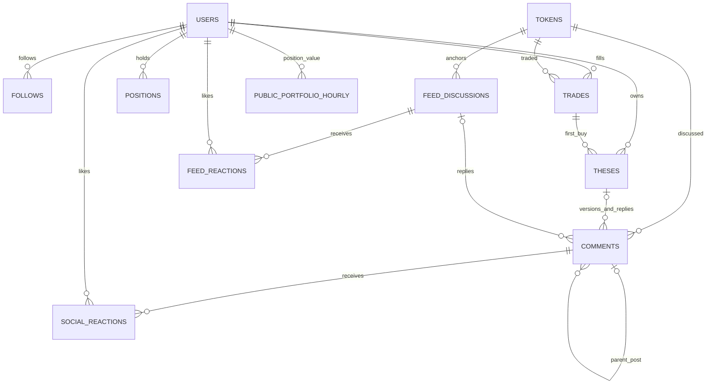
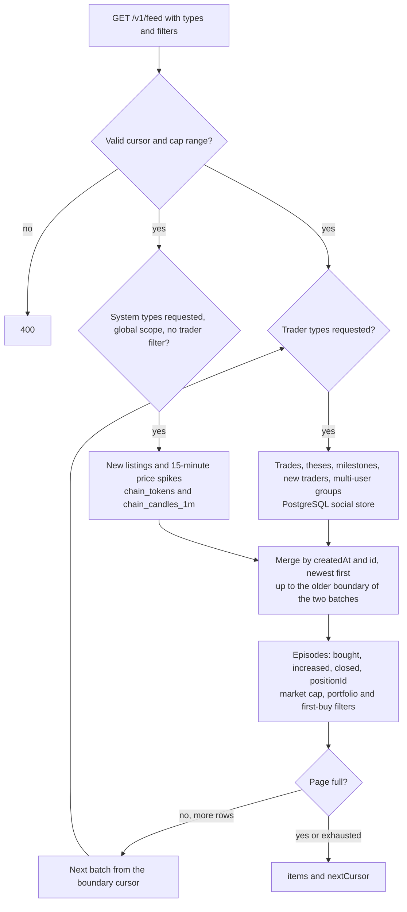

# PostgreSQL social store

Social routes use the same tables, repository, and auth path in demo and live.
With the default demo chain source and `MARKET_DATA_PROVIDER=indexed`, the API runs an idempotent seed
step before listening. Run `bun run db:migrate` first. The seed adds 12 fictional
traders, follows, versioned theses, replies and reactions, and records dated
buys and sells via `PgTradeRepository.record`, including both open and closed
positions. Its timestamps are anchored to the first seed, not shifted on every
read or restart. Use a separate unseeded database with the Yellowstone chain
source or `MARKET_DATA_PROVIDER=live`. In either mode the API, worker, and feed
refuse startup if PostgreSQL contains demo users or seeded social trade
signatures. No rows are erased, and the simulator's source-scoped tables are not
part of this check.
Social content and reactions require verified Privy identity; anonymous readers can
record thesis opens. Seeded accounts are not login identities.



```mermaid
sequenceDiagram
    participant W as Client
    participant A as Hono API
    participant S as SocialService
    participant DB as PostgreSQL
    W->>A: GET /v1/feed or token discussion
    A->>A: Validate cursor, verify optional bearer token
    A->>S: Global or following query
    S->>DB: Read matched trades and thesis versions by descending second and UUID
    DB-->>S: Candidate events
    S->>S: Resolve position episodes, enrich prices, apply filters
    S-->>A: Page and nextCursor
    A-->>W: Social activity
    W->>A: POST thesis version or comment (bearer)
    A->>S: Verified author and validated content
    S->>S: Text moderation; validate position window or same-token parent
    S->>DB: Lock writer, check rate, save discussion
    A-->>W: Stored post with provenance and engagement
    W->>A: GET or POST /v1/feed/{key}/comments; PUT or DELETE /v1/feed/{key}/reaction
    A->>S: Card key and optional viewer for reads; verified viewer for writes
    S->>DB: Resolve card from its indexed activity
    S->>DB: Read replies, or lazily anchor and write engagement
    W->>A: POST /v1/tokens/{mint}/theses/{thesisId}/views
    A->>DB: Atomically increment thesis thread viewCount
    W->>A: GET trader profile, position replay, transactions or history
    A->>DB: Read stored episodes, thesis ranking and position snapshots
```

- Follow targets are wallet addresses, including not-yet-registered wallets.
  Following feed resolves canonical and linked Solana wallet aliases. Follow
  mutations are idempotent; a user may follow 10 new wallets per minute and
  must have three trades before following more than 100 wallets.
- A position is a continuous run from its first buy until its holdings return
  to zero. A thesis identity is unique by wallet, mint, and first buy ID.
  `POST /v1/tokens/{mint}/theses` accepts up to 3,000 characters and an optional
  position ID; if omitted, the most recent position is selected. It creates a
  new immutable version while the position is open or up to three hours after
  closing. If no position exists the API returns 404; an expired window is 409.
- `GET /v1/tokens/{mint}/theses/{thesisId}` lists versions and nested replies
  newest first, and returns any pinned version separately. Only the author can
  pin or unpin a version. Replies use `parentId` and cannot cross token threads.
  Token comments have a 200-character limit. `PUT/DELETE /v1/posts/{id}/reaction`
  sets/removes a like, with one like per viewer and post.
- The text moderation hook rejects external chat invites by default, and the
  database rejects repeated text in a one-minute window and allows up to five
  posts per minute per author. The hook is injectable for additional moderation;
  no third-party or AI moderation service is configured by default.
- All feed cards expose `likeCount`, `replyCount` (including nested replies),
  and `viewerLiked` (false for anonymous viewers). Thesis cards retain their
  existing thread and reaction routes and their `likes`/`likedByMe` fields.
  For other cards use the opaque `discussionKey`: read or post replies at
  `/v1/feed/{key}/comments`, and like or unlike with
  `PUT/DELETE /v1/feed/{key}/reaction`. Parents must be in the same thread.
  Bought, sold, and closed cards attach to the underlying fill; a milestone
  for that fill has its own thread. A multi-user card shares a thread across
  global and following views for the same token, side, and UTC bucket.
  A new-trader thread is tied to the trader, so its replies and likes survive
  discovery of an earlier first fill. Existing threads keep their original token.
- Feed and discussion rows carry `source`; profile and history responses use
  `X-Data-Source`. Seeded leaderboard entries carry `source: demo`. In the
  absence of the webhook/Redis projection, ranking reads derive results from
  PostgreSQL trades and positions using the same window calculations.
- `GET /v1/feed` defaults to trades and theses. `eventType` distinguishes
  bought, increased (a buy into a position that is already open), sold,
  closed, thesis, milestone, multi-user, new-trader, price-spike, and
  new-listing activity. Use the comma-separated `types` filter to select
  variants, including the opt-in derived cards: realized profit of at least
  $1,000 on a sell (with its `positionId`), two or more distinct traders on
  the same token and side in a completed five-minute UTC bucket (with up to
  five `members`, latest first), or a trader's first indexed fill (with the
  trader's `bio`). Reuse the same filters with each cursor. Size applies to
  signed-side USD volume, portfolio size to the trader's currently priced
  holdings (the representative trader on a group card), and cap and change
  since a position's first buy use current market data. Missing prices are
  excluded when a matching price filter is requested.
- System rows have no trader and no thread. They are read from the chain
  ingest tables of the active chain source (the demo simulator in demo mode,
  Yellowstone once its credentials are set), so `source` is `demo` or
  `indexed` accordingly. A new-listing row is a token launch. A price-spike
  row is a completed 15-minute UTC window whose last close is at least 25%
  above its first open on at least $1,000 of volume, dated at the window's
  end; each page scans whole windows in the 24 hours before its cursor and
  steps back while older candles exist. Their market cap is
  the token's current indexed price times its supply. They appear only in the
  global scope and are left out whenever a trader filter is set (`wallet`,
  `minSizeUsd`, `minPortfolioUsd`, `minPriceSinceFirstBuyPct`).


- `GET /v1/traders/{wallet}/positions/{mint}` returns chronological fills,
  average entry, and realized/unrealized PnL for the most recent position or
  a specified `positionId`. `totalInvestedUsd` sums buys and `pnlPct` divides
  realized plus unrealized PnL by that investment. Entry and exit market
  caps are token-weighted estimates using fill price and the implied supply
  available at indexing. They are null when a corresponding fill lacks cap
  data. The `/transactions` subroute returns newest-first fills with
  `page`, `limit`, and inclusive `minSizeUsd`; the total investment is
  independent of the filter.
- The profile includes joined date, trade count,
  average hold across closed positions and, for signed-in viewers, mutual
  followers (people the viewer follows who follow this trader). The
  `followers` and `following` routes are individually paginated. `topTrades`
  lists up to five closed episodes ranked by realized USD PnL, with an
  opening-fill ID for replay. `mostLikedThesis` selects the trader's most liked
  version (newest wins ties) without changing the author's thread pin and
  includes the number of newer versions in that thread. View counts are
  shared by versions in a thread; record an explicit open with
  `POST /v1/tokens/{mint}/theses/{thesisId}/views`. GETs do not count. Views
  are deduplicated for 24 hours by signed-in user or by a hash of the peer IP.
  Anonymous requests are limited to 30 per minute per peer IP.
  The API does not trust forwarded IP headers; clients behind the same proxy
  share its limit.
- The public `portfolio/history` route excludes cash and linked-wallet
  balances. In `24h` it reads hourly UTC public-position snapshots; `7d`
  and `30d` read daily snapshots. Absolute and percentage change are null
  when a window endpoint is missing; percent is also null from a zero
  baseline. `all` keeps the points-only response. Legacy equity-only snapshots
  are omitted.
- `GET /v1/search?q=...` returns `tokens` and public `traders` in one
  response. Trader matches include exact Solana wallet aliases and
  case-insensitive handle or display-name prefixes. If the token provider
  is unavailable, trader results and any indexed token matches still return
  and `tokensUnavailable` is true.
