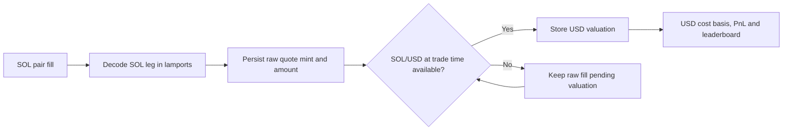
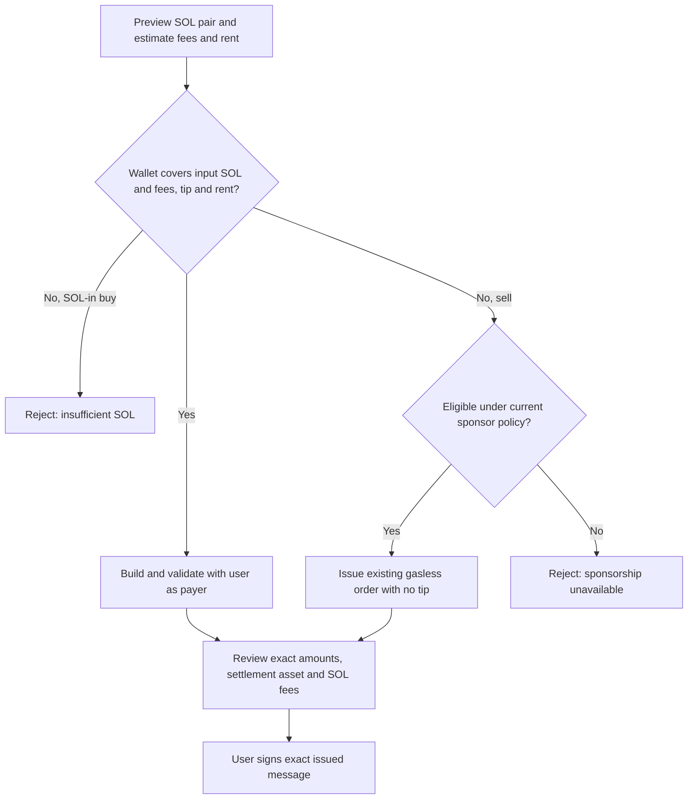
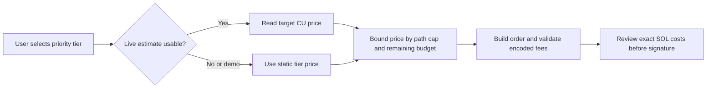
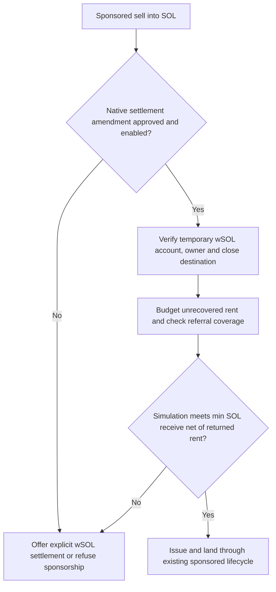

# SOL quote, priority fees, and Jito (v0.2 design)

This design does not change runtime behavior. Demo remains the default for v0.2: previews use demo data and static fee estimates without live keys; no real signing or submission. Today sponsorship is off by default and build/submit reject with the disabled sponsor ([env](../src/config/env.ts), [container](../src/container.ts), [SwapService](../src/services/trading/swap.service.ts)).

## 1. SOL is the quote; USD is the accounting unit

Use SOL-denominated pairs for the SOL pools on pump.fun, PumpSwap, Raydium, and Meteora. The buy ticket takes SOL; the sell ticket takes token quantity and shows expected and minimum receive in SOL. USD is derived display, not a second execution amount. The [swap API](../src/schemas/swap.ts) already takes explicit input/output mints and base-unit strings: use the wrapped SOL mint (`So11111111111111111111111111111111111111112`, 9 decimals) as the SOL pair identifier ([mint list](../src/services/sponsor/swap-mints.ts), [parser](../src/services/helius-parser.ts)). The mint identifier does not promise native settlement.

Prefer SOL when decoding a SOL pair; don't relabel a stablecoin fill as SOL. Today [`parseTrades`](../src/services/helius-parser.ts#L57-L99) nets native SOL and wSOL and tries USDC, USDT, then SOL. Persist raw `quote_mint` and `quote_amount` (integer base units, no floating point) beside USD in [trades](../src/models/trades.ts). Fix [`TradeIndexer.index`](../src/services/trade-indexer.ts#L35-L49): it uses the current SOL/USD price, which misvalues delayed/replayed fills. Use the price at the trade timestamp and keep the raw leg pending valuation if that price is unavailable; don't substitute today's price or zero. Keep USD for [cost basis and realized PnL](../src/repositories/trade.repository.ts#L46-L79) and [leaderboards](../src/services/leaderboard.service.ts#L47-L78). SOL PnL can be a separate optional view. The indexer session owns decoder/storage changes; the backend API-contract owner owns schemas and [OpenAPI](../openapi.json). This PR proposes fields only.



## 2. Choose the fee payer before building

- **User-paid:** prefer the user's wallet as the fee payer whenever spendable native SOL covers the input SOL (if any), base fee, priority fee, selected tip, and rent buffer. Every accepted SOL-in buy is user-paid; reject a buy that leaves too little for fees and rent rather than sponsoring it. The sponsor never registers or signs a user-paid message.
- **Sponsored:** for insufficient fee SOL, e.g. a holder with no SOL selling into SOL, try the existing gasless flow only if the route and wallet qualify. Run the existing [policy](fee-payer-security-policy.md) unchanged: mint/instruction allowlists, simulation, quote binding, caps, quotas, referral coverage and the kill switch. Today a sponsored SOL sell can only settle to wSOL under those checks, or be rejected; no silent downgrade from native SOL to wSOL. Show the actual settlement asset before signing. Don't switch paths after issuance; a changed message requires a fresh review and signature.
- **Separate policy amendment, not active:** replace the minimum $5 USDC wallet balance with $5 of wallet value in allowlisted assets, including SOL, using trusted prices and no credit for assets that cannot be valued. Keep the $5 swap notional rule. Today [eligibility](../src/services/sponsor/validated-fee-sponsor.ts#L129-L169) explicitly tests the USDC balance, live USD prices, notional, and referral economics.



## 3. Priority fees and review

Normal / Fast / Turbo select a target CU price (µlamports per CU), not a guaranteed landing time. Use static tier defaults in demo. For live, estimate against the relevant transaction or writable accounts with Helius `getPriorityFeeEstimate` (**to verify when keys exist**: request shape, tier mapping, units, and freshness). Use the bounded static tier if estimates are missing or stale. Editable order presets in the frontend lane carry the priority tier, optional tip, and slippage. Review the validated built message: show base fee, priority fee, tip and rent separately and total SOL cost, including which wallet pays. Rent is not a network fee.

For both paths require exactly one `SetComputeUnitLimit` (≤1.4M CU), at most one `SetComputeUnitPrice`, and no duplicates. Calculate `base fee = signatures × 5,000` and `priority fee = ceil(CU limit × CU price / 1,000,000)`, matching [`SponsorValidator`](../src/services/sponsor/validator.ts#L313-L323). For selectable pricing, clamp to the lower of the tier target, the CU price cap, and the price that fits the remaining total budget after base fee, rent, and any permitted tip. Reject if fixed costs alone exceed the budget. Sponsored orders retain `MAX_CU_PRICE_MICROLAMPORTS` (2M) and `MAX_LAMPORTS_PER_TX` (10M), with zero tip. User-paid orders use their own higher caps and backend validation before handing the transaction to the wallet. Recheck the issued message at submission; no preset can change a signed message.

Today [`JupiterSwapClient`](../src/services/trading/jupiter-swap.client.ts#L50-L59) sends no fee or wrapping override, and [`SwapService.build`](../src/services/trading/swap.service.ts#L73-L132) validates Jupiter's returned order. Jupiter self-payer builds, managed `/execute` for non-Jito orders, builds suitable for direct Jito submission, native wrap/unwrap behavior, and compatible fee-setting controls are **to verify when keys exist**. If Jupiter controls the fee, validate the encoded price and show it; don't claim the tier was applied or patch a managed order. Reject an over-cap order.



## 4. Jito is user-paid only

The [fee-payer policy](fee-payer-security-policy.md#35-fee-and-signature-caps-v4-v6) prohibits sponsor-to-tip transfers. A user-paid tip is one System transfer **in the swap message**, paid and signed by the user, to one reviewed, pinned Jito tip account. The proposed user-paid validator checks the source, destination, amount and count (zero or one), plus the fee payer, quote invariants and budget from §3. Reject all other unapproved transfers. No separate tip transaction or automatic public-RPC fallback. Putting the tip in the same transaction makes it atomic with the swap; it is not a separate payment on a failed swap.

Behind an off-by-default flag, send the signed user-paid swap via the Jito block engine using `sendTransaction` or a single-transaction `sendBundle`. A private route can reduce public exposure to sandwiching; it does not guarantee protection or inclusion. Jito endpoint and method semantics, tip account pins, regional/auth requirements, privacy properties and status/confirmation mapping are **to verify when keys exist**. A relay acknowledgment is not confirmation. Record the exact signed transaction's signature for reconciliation; on a timeout or ambiguous result leave it `submitted`, with no blind resend or route switch. Sponsored messages never include tips and still land via [Jupiter `/execute`](../src/services/trading/swap.service.ts#L191-L247), which already uses the same unknown → submitted rule.

```mermaid
sequenceDiagram
  participant W as User wallet
  participant A as API
  participant S as FeeSponsor
  participant J as Jupiter
  participant B as Jito block engine
  W->>A: Submit exact signed message
  alt Sponsored, no tip
    A->>S: Validate again and co-sign once
    A->>J: Execute issued order
  else User-paid, Jito enabled and selected
    A->>A: Check issued message, wallet signature and tip
    A->>B: Send signed swap once
  else User-paid, no Jito
    A->>A: Check issued message and wallet signature
    A->>J: Execute issued self-pay order, if supported
  end
  A->>A: Record confirmed, failed or submitted if unknown
  A-->>W: Return status; reconcile unknown without resending
```

## 5. Sponsored native SOL settlement needs policy approval

Today native input wrapping and native output fail closed ([implementation restrictions](fee-payer-security-policy.md#restrictions-and-operational-gaps), [output ATA and SOL balance checks](../src/services/sponsor/validated-fee-sponsor.ts#L172-L234)). Closing a temporary wSOL account sends both its rent and its SOL proceeds to the same destination. If the sponsor paid the rent and the close goes to the user, that rent is a transfer of sponsor SOL to the user, which the [current close rule](fee-payer-security-policy.md#34-instruction-rules) forbids.

**Recommendation, not implemented; requires Jogeshwar's approval:** allow close-to-owner only for sponsored sells into native SOL. Pin the exact supported unwrap shape: temporary wSOL account created in the same message for the user, verified funding and authority, only the user's wallet as the close destination, and no unrelated close or transfer. Validate and simulate the user's native proceeds net of returned sponsor-funded rent against minimum receive. Count that rent once, as unrecovered sponsor spend, within the 10M lamport per-transaction cap and 0.05 SOL/day per-user cap (also reserve it under the global cap). Require referral revenue to cover fees and that rent, as in [eligibility](../src/services/sponsor/validated-fee-sponsor.ts#L129-L169). Keep native SOL input unsupported by the sponsor. A Jupiter order shape with these properties and no disallowed extra signer is **to verify when keys exist**; reject if it cannot be verified.

Alternatives: **persistent wSOL ATA** keeps the existing validation and avoids the rent refund to the user, but leaves wrapped SOL that the user must unwrap separately. **Refuse sponsorship** keeps the policy and native SOL promise intact, but users without SOL need to fund their wallet before selling.



## Defaults and rollout

Proposed configuration only; no env or policy defaults change in this PR.

| Config | Proposed default |
|---|---|
| `USER_PAID_SWAPS_ENABLED` | `false` until the build and validation path is ready |
| `PRIORITY_FEE_NORMAL_MICROLAMPORTS`, `PRIORITY_FEE_FAST_MICROLAMPORTS`, `PRIORITY_FEE_TURBO_MICROLAMPORTS` | `10_000`, `50_000`, `200_000` static starting points |
| `HELIUS_PRIORITY_FEE_ESTIMATE_ENABLED` | `false`; reuse existing `HELIUS_API_KEY` when enabled and verified |
| `USER_PAID_MAX_CU_PRICE_MICROLAMPORTS`, `USER_PAID_MAX_LAMPORTS_PER_TX` | `5_000_000` µlamports/CU; `20_000_000` lamports including tip and rent |
| `JITO_ENABLED`, `JITO_BLOCK_ENGINE_URL`, `USER_PAID_MAX_JITO_TIP_LAMPORTS` | `false`; unset, required if enabled; `10_000_000` lamports (0.01 SOL). Tip selection defaults to zero. Pins are code-reviewed, not client config. |
| `SPONSORED_NATIVE_SOL_SETTLEMENT_ENABLED` | `false`; only introduce the flag after policy approval |

1. Land the design; coordinate the SOL pair and raw quote contract with frontend, backend API and indexer owners. Keep demo keyless.
2. Add user-paid builds and bounded priority presets; enable live estimates only after verification.
3. Add Jito behind its flag; verify atomic tipping, privacy and confirmation before enabling it.
4. After policy sign-off, prove a supported sponsored native SOL sell fixture before enabling that route. Review the wallet-value eligibility amendment separately. Production sponsor gates in the [policy](fee-payer-security-policy.md) still apply.

## Test plan

- Extend [trade indexer tests](../test/trade-indexer.test.ts) with competing SOL and stablecoin legs, base-unit fidelity, and replay using trade-time pricing even when current prices differ. Cover missing historical price without corrupting USD PnL.
- Extend [swap service](../test/swap.service.test.ts) and [route](../test/swaps.routes.test.ts) tests with SOL input/output, self-pay versus sponsor routing, insufficient SOL on buys, deterministic demo pricing, estimator fallback, caps and exact review costs. Use [Jupiter order](../test/fixtures/jupiter-order.json) and [execute](../test/fixtures/jupiter-execute-success.json) fixtures as a baseline; assert no sponsor call in self-pay and no broadcast on a changed message.
- Extend [fee sponsor tests](../test/fee-sponsor.test.ts) for CU price and total-cost boundary/rounding, duplicate compute instructions and sponsor tip rejection. Add user-paid validator cases for wrong source/destination, excess or duplicate tips and flag-off behavior; test Jito timeout/ambiguous status without resubmission. After approval, cover the positive native SOL sell fixture and reject wrong close destination, output shortfall or rent over budget.
