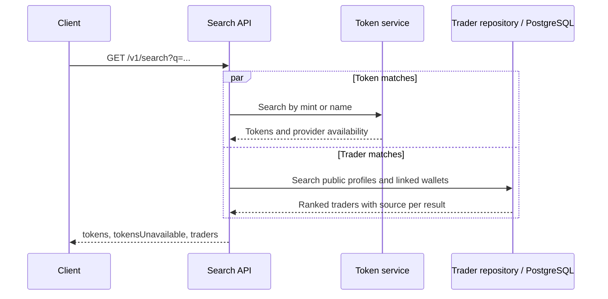

# Trader search

`GET /v1/search?q=...` combines token and public trader results without
authentication. For example, `q=%40north` finds the demo trader `northstar`.
Trader matches are exact, case-sensitive Solana wallets (including linked
wallets), or case-insensitive prefixes of the handle or display name. Prefix
queries can start with `@`. The response includes up to 30 traders, with exact
wallet matches first, then exact handles, then handle and wallet order.

Each trader returns `wallet`, `handle`, nullable `displayName` and `avatarUrl`,
and `source` (`demo` for a seeded profile, `indexed` otherwise). Use the
returned wallet to open `GET /v1/traders/{wallet}`. If the token provider is
unavailable, the response still contains trader matches and any indexed token
matches, with `tokensUnavailable: true`.

The default keyless API seeds the 12 fictional traders in the
[social store](./social.md) before listening. Demo and live use the same search
query and profile routes; live mode uses an unseeded database.

