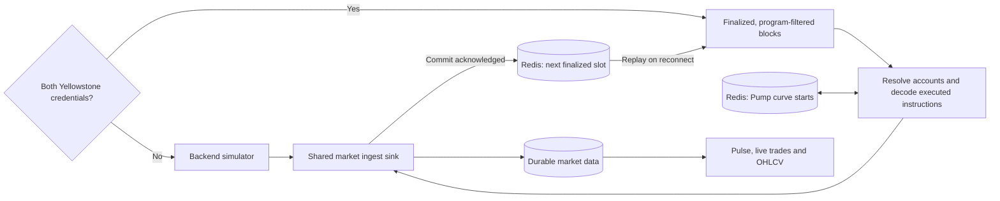

# Yellowstone market indexer

Both market sources implement `ChainEventSource`. At feed startup, call
`createMarketChainSource(simulator).run(marketSink, abortSignal)` under the
existing singleton feed lease; use the same durable market sink for both
sources. Give it an abort signal tied to shutdown and lease loss. The sink
must resolve only once its idempotent write has committed, keyed by
`(source, signature, eventIndex)`. The Helius webhook and its linked-wallet
accounting are independent of market ingestion.

## Configuration and recovery

- Leave `YELLOWSTONE_GRPC_URL` and `YELLOWSTONE_GRPC_TOKEN` blank for demo
  mode. Both are required to select live. Use the HTTPS host and port of a
  Solana **mainnet** Yellowstone endpoint that supports filtered finalized
  blocks and `from_slot` replay. The token is sent as gRPC `x-token`
  metadata over TLS. No live token is needed to run tests.
- On first boot, the indexer starts at the live stream and saves the first
  slot before processing it. It advances the cursor only after the block's
  batch has committed. It reconnects from the first unacknowledged slot;
  overlapping updates below that cursor are ignored, and a sink commit
  followed by a crash can replay once. Configure Redis with durable storage
  and no eviction for the cursor and reserve keys.
- End-of-stream, idle connections, storage errors and replay gaps trigger
  capped exponential backoff with jitter. Parent slots distinguish skipped
  Solana slots from missing finalized blocks. An expired replay window
  does not switch to live head or demo; operators must backfill the gap or
  explicitly choose a new start cursor before resuming. The cursor key is
  `agele:chain:solana-mainnet:yellowstone:next-slot`.
- Events use Solana block time in Unix seconds, or `null` if unavailable.
  They are ordered by slot, transaction index and executed instruction
  ordinal. Never use network arrival time for historical candles.

## Decoding

| Venue | Instructions covered |
| --- | --- |
| pump.fun | `create` / `create_v2`, legacy and v2/v3 buys and sells, `migrate` / `migrate_v2` |
| PumpSwap | Original and v2 buy, buy-exact-quote-in, and sell |
| Raydium AMM v4 | Base-in and base-out, including the v2 orderbook-free layouts |
| Raydium CPMM / CLMM | Base-in and base-out / swap and swap-v2 |
| Meteora DLMM | Swap, exact-out, and price-impact variants |
| Meteora DAMM v1 / v2 | Swap / swap and swap2 |

The decoder resolves versioned and lookup-table addresses, reconstructs CPI
ownership from stack heights, and emits one event per recognized instruction.
It skips failed transactions, undecodable or ambiguous fills, and successful
but idempotent Pump migrations with no pool creation. Historical Pump
withdrawals and generic pool creations are not migrations.

Pump fills use the program's trade event for the base leg and native quote;
token-quoted curves use their actual scoped quote transfer. V3 graduation
buys combine the curve and post-completion event amounts under one
instruction identity. Other fills
use the executed SPL vault transfers, not requested amounts or aggregate
transaction deltas. Amounts are integer strings in mint base units; they do
not include network fees or attempt USD conversion. SPL transfer amounts
are gross of any Token-2022 withholding. DAMM v1 includes its explicit
user-to-protocol input fee leg. PumpSwap uses the program's base/quote
orientation. Other pools prefer SOL, then USDC, then USDT as quote, and
otherwise use stable mint order. This is not a token allowlist.

For live Pump launches, the on-chain create event provides initial reserves;
subsequent fills supply current reserves for curve progress, including across
restarts. A curve whose start was not observed has no progress value until
its launch has been backfilled; the decoder does not assume a fixed supply.

Program layouts are from the [Pump and PumpSwap IDLs](https://github.com/pump-fun/pump-public-docs/tree/main/idl),
[Raydium AMM](https://github.com/raydium-io/raydium-amm/blob/master/program/src/instruction.rs),
[Raydium CPMM](https://github.com/raydium-io/raydium-cp-swap/tree/master/programs/cp-swap/src/instructions),
[Raydium CLMM](https://github.com/raydium-io/raydium-sdk-V2/blob/master/src/raydium/clmm/instrument.ts),
[Meteora DLMM](https://github.com/MeteoraAg/dlmm-sdk/blob/main/ts-client/src/dlmm/idl/idl.json),
[DAMM v1](https://github.com/MeteoraAg/dynamic-amm-sdk/blob/main/ts-client/src/amm/idl.ts)
and [DAMM v2](https://github.com/MeteoraAg/damm-v2-sdk/blob/main/src/idl/cp_amm.json).
See the [recording provenance](../test/fixtures/yellowstone/README.md).
